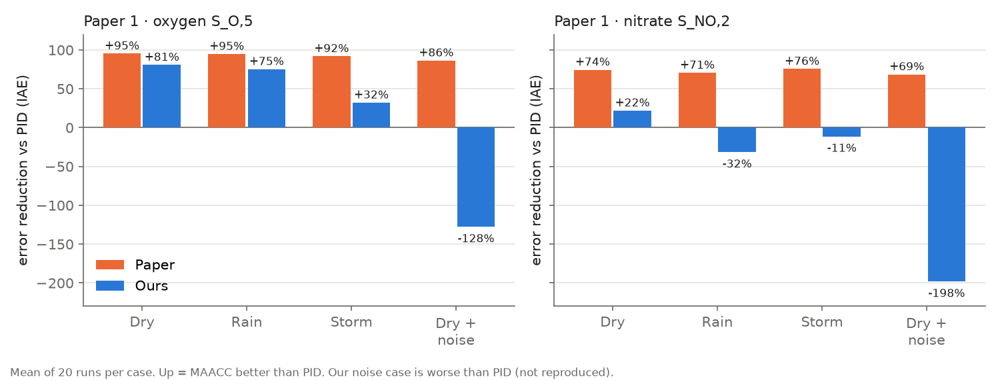
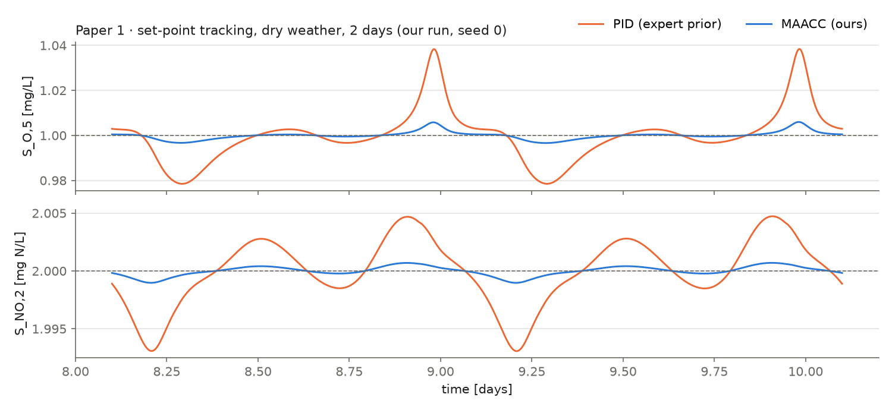
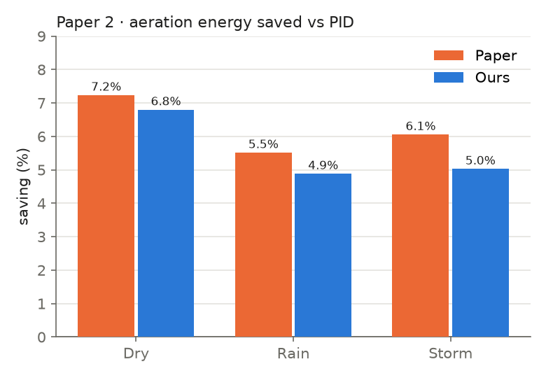

# RL control of a wastewater treatment plant

We rebuilt the standard BSM1 plant in code, reimplemented two base papers on it,
and improved the RL agent of the second. Every number below comes from
`results/`; `docs/05_results.md` is generated from those files.

## The two base papers

| | **Paper 1: MAACC** (Wang et al., IEEE T-II 2026) | **Paper 2: floating DO** (Du et al., Sci China Tech Sci 2023) |
|---|---|---|
| **What it is** | Two RL agents (oxygen, nitrate) on top of a PID. The learned part starts at zero, so day one is plain PID. | One DDPG agent that lets oxygen float instead of holding 2 mg/L, to save aeration energy. |
| **Main claimed result** | Tighter tracking than other methods, robust to actuator noise, over 90% training success. | 5–7% less aeration energy than PID, effluent still within limits. |
| **How we re-obtained it** | Reimplemented the agents, PID gains, setpoints and both test protocols (Table II clean, Table III noise). 20 runs per case, as in the paper; 360 runs in all. | Reimplemented environment, rewards, DDPG, PID and fuzzy comparators. All 3 weathers. |
| **What we got** | Oxygen error vs PID: **−81%** dry, **−75%** rain, **−32%** storm (paper −95/−95/−92%). Nitrate: median run −84% dry, −83% rain (paper −74/−71%); storm no gain. Runs that beat PID: **18/20** dry and rain (paper: >90%). Under the noise test: **not reproduced** — worse than PID. | Saving reproduced: dry **6.8%** (paper 7.24), rain **4.9%** (5.52), storm **5.0%** (6.06). |
| **Verdict** | **Reproduced for dry and rain; not for storm nitrate or noise** | **Reproduced** |

### Paper vs ours







Orange = the papers' published numbers (from their tables); blue = our runs.
Paper 1's nitrate bars are means: two bad runs out of 20 pull rain below zero,
while the typical run is 83% better than PID. Redraw with
`python experiments/19_readme_figures.py`.

Paper 1 needed bigger learning steps than our first, cautious version, plus a
safety fallback we added: if the learned part makes tracking clearly worse, it
is reset to zero and the PID takes over smoothly. Without it 8 of 20 runs
diverged in the first hour. Under the noise test our PID itself gets 3× worse
(the paper's only 10%), so the noise there must reach the plant differently.
Not checked: its table against seven other methods, and its stability proof.

Neither paper runs exactly as published. Paper 1's critic update (eq. 15)
diverges, and our first actor did not follow eq. (8) (it drifted into its clip
and acted as a constant offset; fixed and tested). Paper 2's state is not
Markov, its 45 s decision step is too short for the ammonia response, and its
critic gradient has the wrong sign early on. Details: `docs/02`, `docs/04`,
`docs/REPRODUCTION.md`.

## What we found that the papers do not report

The energy saving is bought by breaking the ammonia limit far more often:

| weather | saving | time above 4 g N/m³ (DDPG-B) | PID |
|---|---|---|---|
| dry | 6.8% | 38.1% | 12.2% |
| rain | 4.9% | 35.2% | 19.6% |
| storm | 5.0% | 37.0% | 23.2% |

## Our contribution: a better RL network

Four changes to paper 2's agent: **(1)** a 2-hour influent forecast as input,
**(2)** a risk-aware critic that optimises the worst 30% of outcomes,
**(3)** violation budgets via Lagrange multipliers instead of hand-tuned
weights, **(4)** a learned plant model for extra training data.

Same objective, arms differing only in the network; gap versus paper 2's agent
at equal violation rate (positive = cheaper):

| forecast only | risk-aware critic only | both |
|---|---|---|
| +19.5 kWh/d | +25.9 kWh/d | **+28.6 kWh/d** |

## Limits (read these)

- Everything is simulated. The plant and influent are rebuilt from the model
  definition, not the official files, so numbers match the papers in direction,
  not exactly.
- Each sweep point is a single seed, and our agent has more inputs than paper
  2's, so part of the gain could be capacity.
- Change (4) did not work: it saves training data but broke the ammonia limit
  (14% → 67% violations), and our attempted fix did not help.
- The forecaster's weather-class head is at chance on fresh scenarios; its
  95.8% validation accuracy was a leak from overlapping windows. The flow and
  ammonia forecasts themselves hold up on unseen data.
- Two of our own earlier claims were withdrawn after the full benchmark.

## Project website

`docs/` is a static site: an overview with a claim-by-claim verification
ledger, one interactive page per base paper, and one for the prediction
models. Open `docs/index.html` directly, or publish it via Settings → Pages →
branch `claude/water-resource-ml-prediction-680kno`, folder `/docs`. Data comes
from `docs/data/site-data.js`, built by `experiments/14_build_site_data.py`.

## Run it

```bash
pip install -r requirements.txt
python -m pytest tests -q                  # 75 tests
python experiments/09_write_results.py     # regenerate docs/05_results.md
```

RL learners reproduce exactly at the benchmark's thread count (`--threads 2`);
with other counts they land elsewhere on the same energy/violation trade-off.

Docs: `docs/00_code_walkthrough.md` (modules), `01`–`02` paper 1, `03` our
contribution, `04` paper 2, `05` results, `07_viva_prep.md` (questions to
expect), `09_faculty_speech.md` (two-minute talk), `STATUS.md` (what is left).
