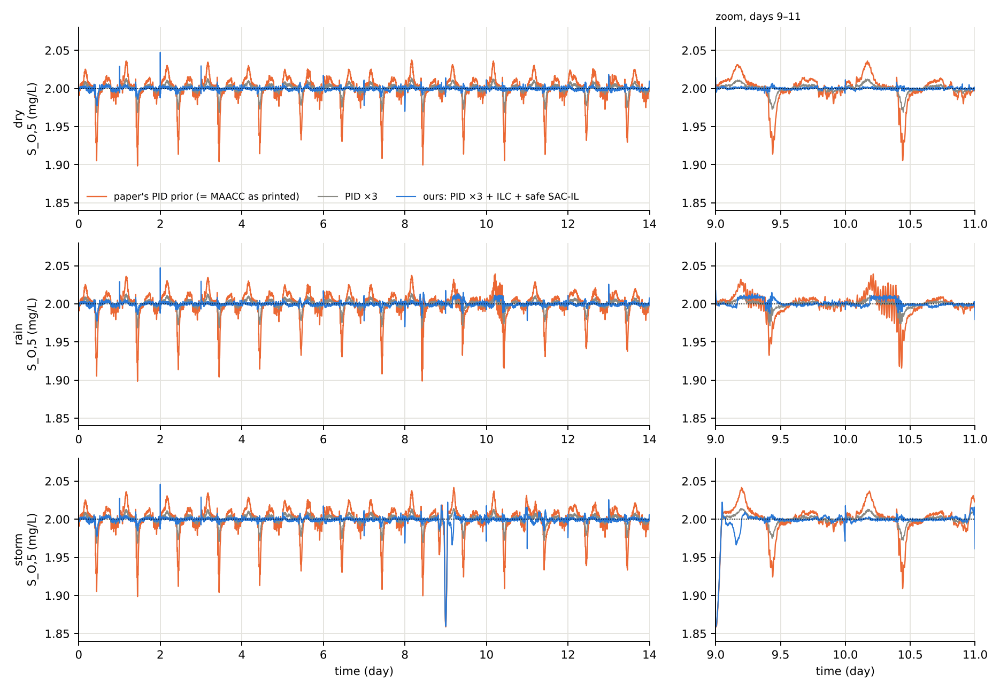
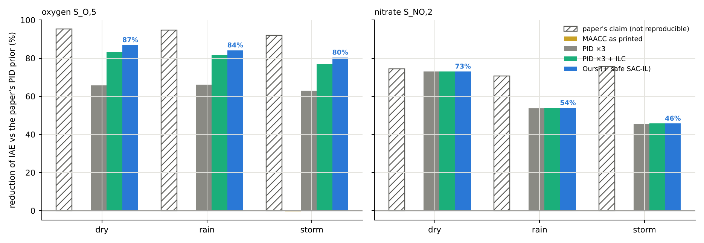
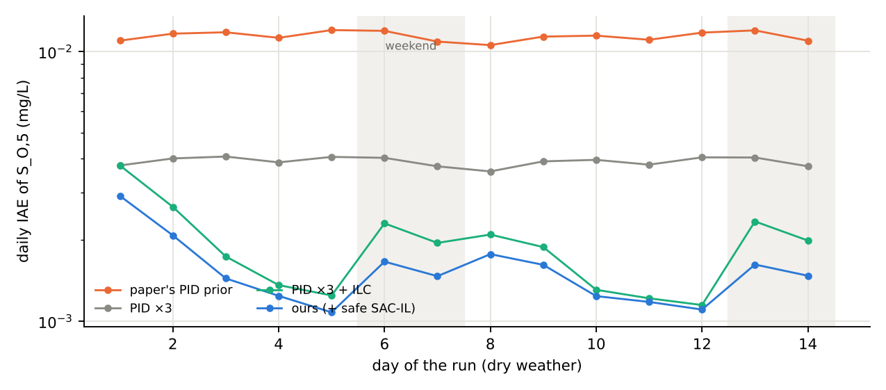
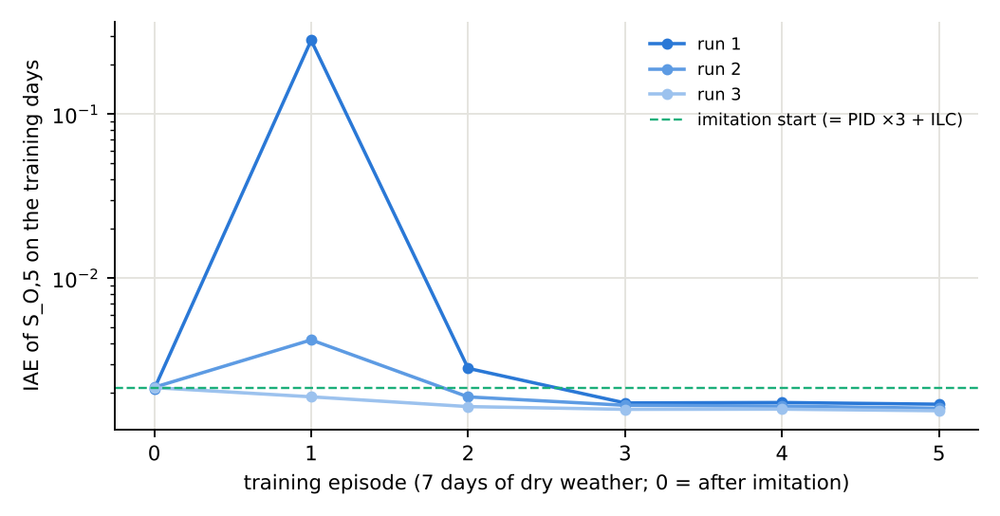
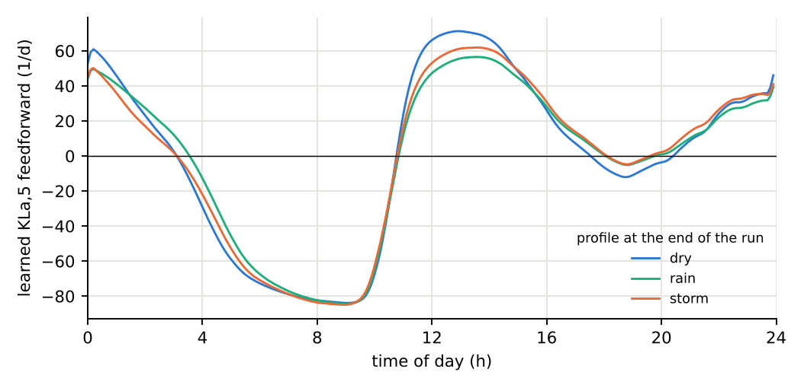

# Paper 1: a new controller with SAC, imitation learning and iterative learning control

Paper 1 (Wang et al., IEEE T-II 2026) controls the oxygen in tank 5
(S_O,5 → 2 mg/L, through KLa,5) and the nitrate in tank 2 (S_NO,2 → 1 mg/L,
through Q_a) with MAACC: an adaptive critic that adds a learned correction to
an expert PID. Run exactly as printed, MAACC stays equal to its PID
(`docs/REPORT.md`). We replace MAACC by a new controller built from the same
expert knowledge and test it under the paper's own protocol.

## The controller

`u_k = u_k-1 + ΔPID_k(gain 3) + f_ILC(time of day) + SAC-IL correction (oxygen loop), with a safety gate`

1. **Retuned expert prior.** Paper 1's own PID with all gains ×3, chosen on
   dry weather as the largest factor below 70 % of the factor where the loop
   oscillates (×5).
2. **Daily iterative learning control (ILC).** About 96 % of the remaining
   oxygen error repeats every day: the PID reacts only after the daily load
   peaks have moved the oxygen. The ILC learns, day by day, the aeration
   correction the PID had to make at each time of day and applies it 3
   minutes earlier (feedback-error learning; share 0.5 per day, moving-average
   smoothing over ±11 min). It learns online, from zero, during the run.
   `src/wwtp/sacil/ilc.py`.
3. **SAC with imitation learning (SAC-IL).** A soft actor-critic learns a
   bounded extra correction of the aeration on top of PID + ILC.
   * Imitation: the actor is first trained to reproduce the expert
     (behaviour cloning on recorded expert runs), so learning starts from the
     expert, not from random actions.
   * SAC: twin critics, entropy term, the expert demonstrations kept in the
     replay data, and a behaviour-cloning term that never fades below a floor.
     Without that floor the loops became unstable after a few episodes.
   * Inputs: last three errors of both loops, both inputs, measured influent
     flow. Reward: absolute errors of both loops, each scaled by the retuned
     prior's error, so neither loop is traded for the other.
   * The nitrate loop is left to the PID: when SAC was allowed to move Q_a
     it lowered the oxygen error by worsening nitrate.
   `src/wwtp/sacil/sacil.py`.
4. **Safety gate.** Each input is clipped to the range seen in training. In a
   period where an input leaves that range by more than 10 % of its width, or
   where the expert would need a larger correction than the learner's bound
   (under actuator noise), the learned correction is switched off and PID + ILC
   act alone. `experiments/30_sacil_guard.py`.

## Protocol

Same as for the reimplementation: official BSM1 (bsm2-python 0.0.16), official
influent, 14-day dry warm-up under the paper's PID, then 14 days at 45 s.
SAC-IL and every setting of the ILC and the gain were chosen on **dry weather
only** (SAC-IL trained on days 0-7 of the dry file, 5 episodes). Rain, storm
and the noise test were never used for training or tuning. Three independent
training runs; the table gives their mean.

## Results

IAE over 14 days; percentages against the paper's PID prior (which MAACC as
printed equals).

| Case | Paper's PID | PID ×3 | + ILC | **Ours: + safe SAC-IL** | Paper's claim (MAACC) |
|---|---|---|---|---|---|
| Dry, oxygen | 0.0114 | 0.0039 (−66 %) | 0.0019 (−83 %) | **0.0015 (−87 %)** | 0.00053 (−95 %) |
| Rain, oxygen | 0.0108 | 0.0036 (−66 %) | 0.0020 (−81 %) | **0.0017 (−84 %)** | 0.00051 (−95 %) |
| Storm, oxygen | 0.0118 | 0.0044 (−63 %) | 0.0027 (−77 %) | **0.0023 (−80 %)** | 0.00095 (−92 %) |
| Dry + noise, oxygen | 0.0249 | 0.0185 (−26 %) | 0.0185 (−26 %) | **0.0189 (−24 %)** | 0.0017 (−86 %) |
| Dry, nitrate | 0.0064 | 0.0017 (−73 %) | 0.0017 (−73 %) | **0.0017 (−73 %)** | 0.0037 (−74 %) |
| Rain, nitrate | 0.0107 | 0.0050 (−54 %) | 0.0050 (−54 %) | **0.0049 (−54 %)** | 0.0060 (−71 %) |
| Storm, nitrate | 0.0104 | 0.0057 (−46 %) | 0.0057 (−46 %) | **0.0057 (−46 %)** | 0.0048 (−76 %) |

The paper's percentages are against its own PID row; ours against our PID,
which matches the paper's PID for oxygen (0.0114 vs 0.0114 dry).

Without the safety gate, SAC-IL is better on dry weather but worse than PID ×3
+ ILC on rain (0.0042) and storm (0.0037): some inputs leave the training
range. The gate is active 12 % of the time in rain, 6 % in the storm, 0 % in
dry weather and 54 % under actuator noise.











## What each part contributes (oxygen, dry → rain → storm)

* PID ×3: −66 / −66 / −63 % (no learning; more actuator movement, same energy)
* + daily ILC: −83 / −81 / −77 % (the largest single step after the gain)
* + safe SAC-IL: −87 / −84 / −80 %

## Honest reading

* The new controller is obtained under the paper's protocol, from the paper's
  own expert, and holds in weather it never saw. MAACC as printed gives 0 %.
* It does not reach the paper's claimed −92 to −95 % on oxygen, which we could
  not obtain with any setting the paper allows.
* Nitrate is not improved beyond the retuned PID. The nitrate loop is fast and
  its error does not repeat from day to day, so neither ILC nor SAC-IL helped.
* Under actuator noise nothing beats the retuned PID: the error there is the
  noise itself.
* The ILC relies on the daily repetition of the BSM1 influent; on a real plant
  that repetition is weaker (holidays, events) and the weekend days in the
  figure show what happens when a day differs.

## Reproduce

```bash
python experiments/28_sac_il_paper1.py --seed 0 --episodes 5 --train-days 7 --noise-runs 10 --ilc --balanced --oxygen-only --tag sacil_ilc   # also --seed 1, 2
python experiments/29_ilc_paper1.py          # PID, PID x3, with and without ILC
python experiments/30_sacil_guard.py         # SAC-IL with and without clipping and the gate
python experiments/31_paper1_new_method.py   # table (results/summary_paper1_new.json) and figures
```
