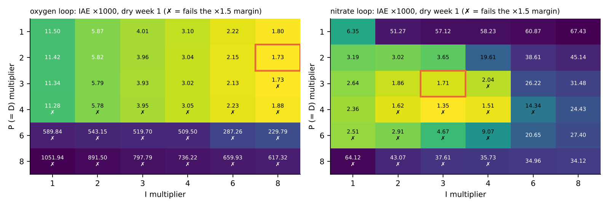
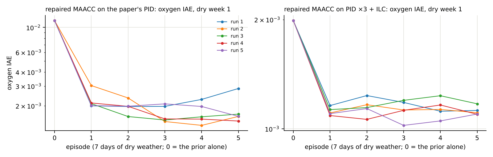
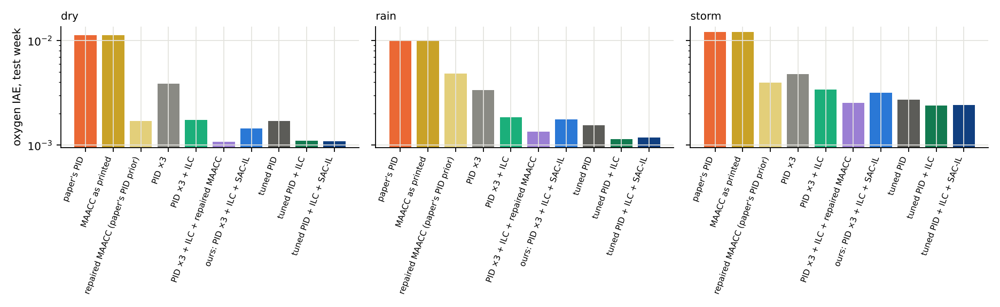
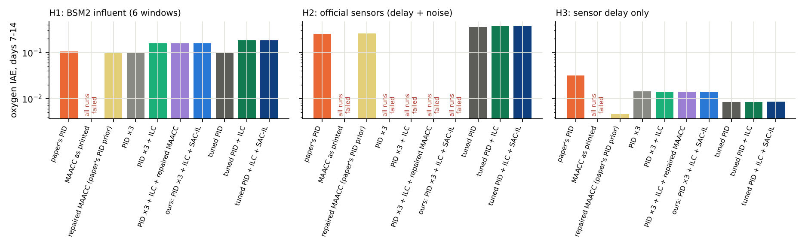

# Paper 1: stronger baselines and a held-out test

The study (`docs/PAPER1_STUDY.md`) compared our controller with paper 1's
PID and with MAACC as printed (which does not learn). A reviewer would ask
three questions, answered here step by step:

1. Is our learner better than a **repaired** version of the paper's learner?
2. Is the gain more than **good PID tuning**?
3. Does it hold on data and conditions that **nothing was tuned on**?

Every setting and training run below uses dry weather days 0–7 only, as in
the study. Numbers: `results/paper1_heldout_tables.json`; figures:
`docs/figures/heldout/`.

---

## Step 1. A fairly tuned PID

The study's PID ×3 multiplies all of the paper's gains by one factor. Here
the P and I gains are tuned separately for each loop, with a budget and rule
fixed before the run (`experiments/38_tuned_pid.py`):

* P and I multipliers each in {1, 2, 3, 4, 6, 8} (36 settings per loop; D
  multiplier = P multiplier), oxygen loop first, then nitrate.
* Stability margin: a setting counts only if it still works with all its
  multipliers ×1.5 (PID ×3 passes this rule).
* The admissible setting with the lowest error on dry week 1 is chosen; the
  daily ILC is then re-tuned for it with the study's grid and rule.

Result: oxygen loop **P ×2, I ×8, D ×2**; nitrate loop **×3** (as before).
ILC for it: β = 1.0, lead 4 steps, smoothing ±30. Oxygen error on dry
week 1: 0.00173 (PID ×3: 0.00393); with the ILC 0.00115. The chosen
oxygen setting is at the edge of the grid (I ×8), so a larger budget could
find a still better PID.



## Step 2. Paper 1's MAACC with repaired training

`src/wwtp/sacil/maacc_repaired.py`. Built as MAACC is: one agent per loop,
each action network sees its own loop and outputs an input increment, each
critic sees both loops and both actions, the action network starts at zero
(so the controller starts as its PID prior, u = a + b). Repaired with the
standard fixes for an actor-critic that does not learn (MATD3): replay
buffer, target networks, twin critics, target-policy smoothing, normalised
inputs and reward, a bounded increment, delayed actor updates. It does
**not** have imitation learning or the entropy term, which are what SAC-IL
adds. Same data and budget as SAC-IL (dry week 1, 5 episodes of 7 days),
5 training runs each, in two set-ups:

* **on the paper's PID** (both loops, as paper 1);
* **in our stack**: oxygen loop only, on PID ×3 + ILC, with the same safety gate.

A first version also learned offline from the expert's run alone (where the
action never varies); its actor drifted before acting (oxygen error 0.014 to
0.21 at the start). It was replaced by the standard TD3 warm-up (one day of
exploration before the first update). Both are in the git history.



**The repaired MAACC learns.** On the paper's PID, its oxygen error on dry
week 1 falls from 0.0115 to 0.0013–0.0023 (the policies kept, after 3–5
episodes), and nitrate from 0.0064 to 0.0020–0.0028. So the paper's idea can work. As printed, its
training is what fails.

## Step 3. All controllers on the study's test week

Official files, week 2 (as in the study), oxygen IAE and change against the
paper's PID; learned controllers: mean of 5 runs.

| Controller | Dry | Rain | Storm | Dry + actuator noise (14 d) | Aeration movement (dry) |
|---|---|---|---|---|---|
| Paper's PID | 0.0113 | 0.0100 | 0.0120 | 0.0249 | 501 |
| MAACC as printed | 0 % | 0 % | 0 % | 0 % | 501 |
| **Repaired MAACC** (paper's PID prior) | −85 % | −52 % | −67 % | −13 % | 1835 |
| PID ×3 | −66 % | −67 % | −60 % | −26 % | 966 |
| PID ×3 + ILC | −85 % | −82 % | −72 % | −28 % | 961 |
| PID ×3 + ILC + repaired MAACC + gate | **−91 %** | −87 % | −79 % | −22 % | 1489 |
| Ours: PID ×3 + ILC + SAC-IL + gate | −87 % | −82 % | −74 % | −27 % | 982 |
| **Tuned PID** | −85 % | −85 % | −77 % | −22 % | 852 |
| **Tuned PID + ILC** | −90 % | **−89 %** | **−80 %** | −23 % | 852 |
| Tuned PID + ILC + SAC-IL + gate | −90 % | −88 % | −80 % | −22 % | 874 |

Nitrate: all PID ×3 and tuned-PID controllers −73 / −46 / −34 % (dry / rain /
storm). The repaired MAACC on the paper's PID: −62 / −5 / +6 %.



What this shows:

* **A tuned PID alone is as good as our full controller** (dry −85 vs −87 %;
  rain and storm better), with less actuator movement. The ×3 baseline was
  too weak.
* **Tuned PID + ILC is the best simple controller**, and the ILC is the part
  that adds most on top of any PID (×3: −66 → −85 %; tuned: −85 → −90 %).
* **SAC-IL adds nothing on the tuned PID + ILC** (−90 / −88 / −80 % with it,
  −90 / −89 / −80 % without).
* **In the same stack, the repaired MAACC beats SAC-IL** (−91 / −87 / −79 %
  against −87 / −82 / −74 %), at about 1.5× the aeration movement.
* The repaired MAACC on the paper's PID reaches −85 % in dry weather, close
  to the paper's claim, but generalises less to rain and storm, and moves
  the aeration about 4× as much as the PID.

## Step 4. The held-out test (pre-registered)

The protocol (`docs/PAPER1_HELDOUT_PROTOCOL.md`) was committed and pushed
before any held-out run (commit `72d1d14`). Amendment 1, which adds SAC-IL on
the tuned PID, came after the test-week results of step 3 and still before
any held-out run (`f1245d2`). The frozen controllers were pushed in `22b53fa`
before the results. Nothing was re-tuned or retrained.

* **H1: new influent.** The official BSM2 influent (609 days), six 14-day
  windows through its evaluation year; ideal sensors.
* **H2: real sensors.** Official dry, rain and storm files with the official
  BSM1 sensor models (oxygen: 1-min response; nitrate: 10-min response;
  noise 0.25 g/m³ on both), 3 noise seeds.
* **H3: sensor delay only.** As H2 without the noise.

Score: oxygen IAE on days 7–14 from the true concentrations. A run whose
oxygen leaves 0.3–4 mg/L is a failure (excluded from the means and counted).

| Oxygen IAE, days 7–14 | H1: BSM2 influent | H2: official sensors | H3: sensor delay |
|---|---|---|---|
| Paper's PID | 0.105 | 0.255 (2 of 9 runs failed) | 0.0319 |
| MAACC as printed | all failed | all failed | all failed |
| Repaired MAACC (paper's PID prior) | **0.099 (−6 %)** | 0.261 (2 of 45 failed) | **0.0046 (−86 %)** |
| PID ×3 | 0.100 (−6 %) | all failed | 0.0145 (−55 %) |
| PID ×3 + ILC | 0.160 (+52 %) | all failed | 0.0141 (−56 %) |
| PID ×3 + ILC + repaired MAACC + gate | 0.160 (+52 %) | all failed | 0.0140 (−56 %) |
| **Ours**: PID ×3 + ILC + SAC-IL + gate | 0.160 (+52 %) | **all failed** | 0.0141 (−56 %) |
| Tuned PID | **0.098 (−7 %)** | 8 of 9 failed | 0.0084 (−74 %) |
| Tuned PID + ILC | 0.185 (+76 %) | 0.379 (+48 %) | 0.0085 (−73 %) |
| Tuned PID + ILC + SAC-IL + gate | 0.185 (+75 %) | 0.379 (+48 %) | 0.0085 (−73 %) |



**The pre-declared comparisons for ours** (better = lower mean **and**
better in at least two thirds of the windows or runs):

| Ours vs | H1 | H2 | H3 |
|---|---|---|---|
| (a) PID ×3 + ILC | equal (0 %), not better | ours failed every run | −0.0 %, 2 of 3: better by the rule, but the difference is negligible |
| (b) PID ×3 + ILC + repaired MAACC | equal, not better | both failed | +1 %, not better |
| (c) tuned PID + ILC | −13 %, 6 of 6: better | ours failed | +67 %, not better |
| (d) paper's PID | +52 %, not better | ours failed | −56 %, 3 of 3: better |
| (e) tuned PID + ILC + SAC-IL vs tuned PID + ILC | 0 %, not better | 0 %, not better | 0 %, not better |

### What happened

* **H1 overloaded the plant.** The BSM2 influent is raw sewage meant to pass
  a primary clarifier first; fed straight into BSM1, the aeration sits at its
  limit about 30 % of the time in every window, so tracking errors are ten
  times larger for every controller. We did not foresee this when writing
  the protocol; it turned H1 into a test of saturation. Under saturation
  **the ILC makes things worse** (+52 % on PID ×3, +76 % on the tuned PID):
  it learns a feedforward the actuator cannot deliver and adds it when the
  saturation ends. The ILC needs anti-windup (stop learning at a limit).
* **H2: the high-gain controllers do not survive real sensor noise.** With
  the official sensors (noise 0.25 g/m³), PID ×3 and every controller built
  on it leave the safe range within half a day; the tuned PID fails 8 of 9
  runs. The paper's PID and the repaired MAACC on it finish most runs (each
  lost the same noise seed in dry and storm), and the tuned PID + ILC
  finishes all, with a 48 % larger error than the paper's PID. The paper's
  lower gains are more robust here; the official BSM1 PI controller uses
  lower gains still.
* **H3: with sensor delay, the repaired MAACC is the best controller**
  (−86 %), better than every PID, including the tuned one (−74 %).
* **The safety gate switches the learned parts off on new conditions**
  (96–100 % of the time in H1–H3), so they add nothing there, but also do no
  harm: the learned controllers in the stack equal their base.
* MAACC as printed failed every held-out run.

## Step 5. What this changes

**What still holds:**

* MAACC as printed does not learn and fails every held-out condition.
* On the official data, the paper's PID can be improved by 80–90 % on
  oxygen, and the daily ILC is the most useful single addition.

**What changes:**

* Our controller's gain on the official data is matched by a tuned PID and
  beaten by a tuned PID + ILC. SAC-IL adds nothing on the tuned PID + ILC,
  and in the same stack the repaired MAACC does better than SAC-IL.
* Ours does not generalise to the held-out conditions: it fails under the
  official sensor noise and is worse than the paper's PID under overload.
  None of the high-gain designs is robust to sensor noise.
* The paper's learner, repaired, is the most robust learned controller here:
  it learns (−85 % dry on the official data), survives the sensor noise as
  the PID does, and is the best under sensor delay.

**The honest contribution now** is a reproducibility and robustness study:
paper 1's MAACC does not work as printed, but works once its training is
repaired; on nominal data a tuned PID with a daily ILC is as good as any
learner tried; and the realistic held-out conditions show what every
design is missing (sensor-noise robustness, ILC anti-windup), which the
paper's nominal test hides.

## Next steps this points to

1. ILC with anti-windup: freeze learning while the actuator is at a limit
   (H1).
2. Robustness to sensor noise: filter the measurements, limit the gain at
   high frequency, or train the learner with the official sensor models
   (H2); then a new held-out set (e.g. other noise seeds and windows).
3. Repaired MAACC with a movement penalty (it moves the aeration 3–4×).
4. A fair gain budget for every learner and PID on a validation set separate
   from both the training week and the test.

## Reproduce

```bash
python experiments/38_tuned_pid.py                                   # step 1
python experiments/39_maacc_repaired.py --mode paper --seed 0        # step 2, seeds 0-4, also --mode stack
python experiments/28_sac_il_paper1.py --seed 0 --episodes 5 --train-days 7 --noise-runs 0 --ilc --balanced --tuned --tag sacil_tuned   # seeds 0-4
python experiments/33_paper1_study.py --only PIDtuned PIDtuned+ILC rMAACC PIDx3+ILC+rMAACC OursT   # step 3
python experiments/40_paper1_heldout.py                              # step 4 (468 runs)
python experiments/41_paper1_baselines_heldout_doc.py                # tables and figures
```
