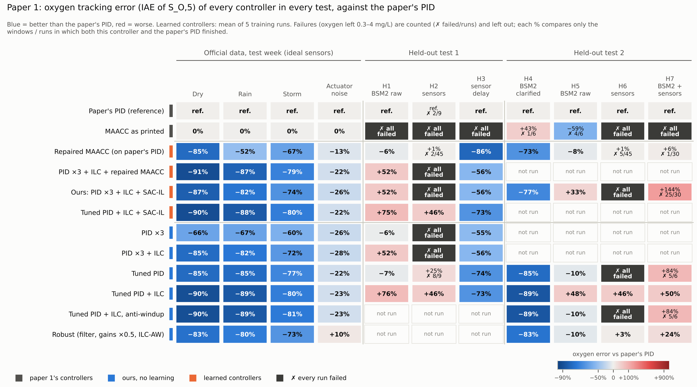
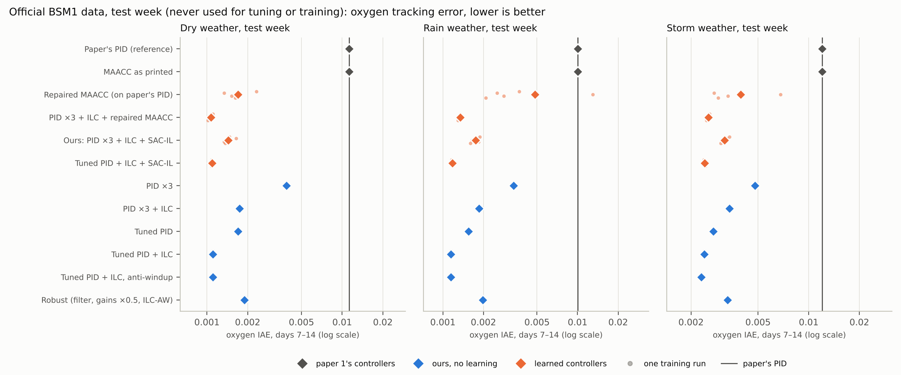
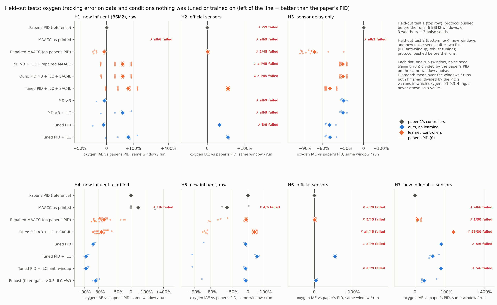
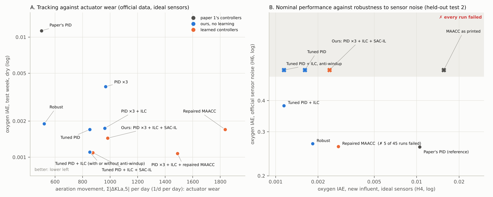
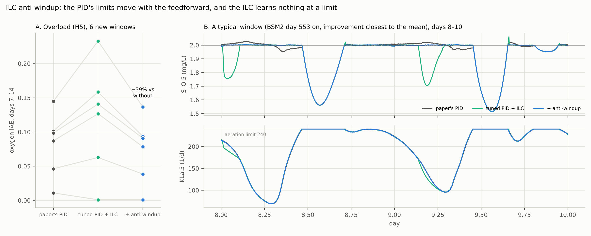
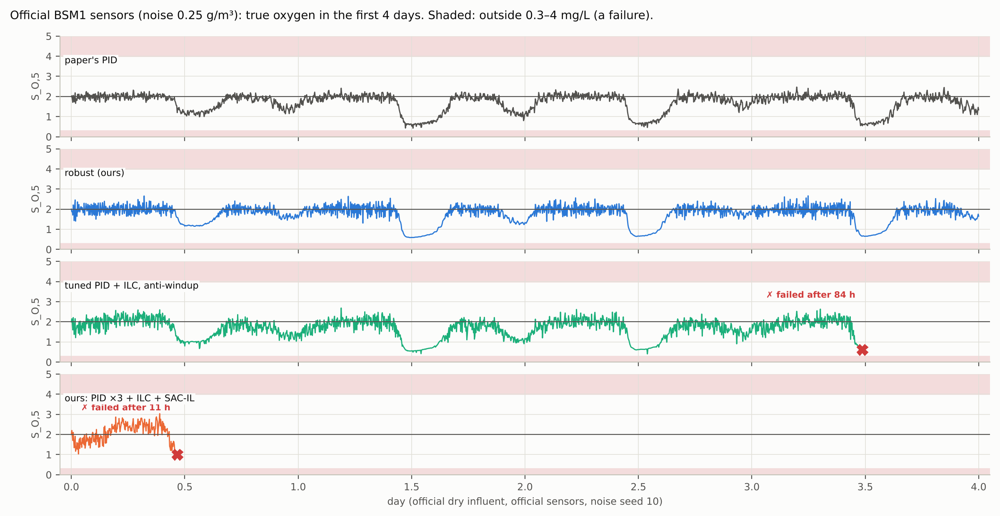
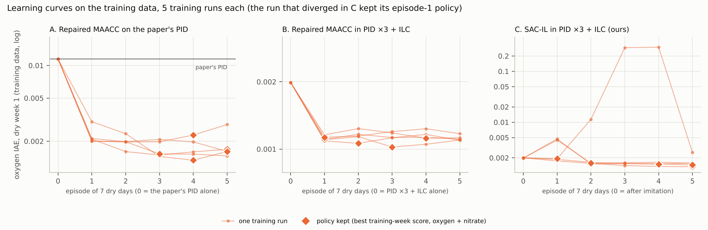

# Paper 1: final figures

All figures are drawn by `experiments/45_paper1_figures.py` from the result
files; no number is typed in by hand. The numbers behind figure 1 are in
`results/paper1_final_figure_table.json`.

**Conventions in every figure**

* Colour is the controller's family:
  * grey: paper 1's controllers;
  * blue: ours, without learning;
  * orange: learned controllers.
* The paper's PID is the reference line.
* "Failure" means the true oxygen left 0.3–4 mg/L and the run stopped. A
  failure is never drawn as a value: it is marked ✗ and counted.
* Learned controllers have 5 training runs each.
* Every test scores days 7–14, using the true concentrations.

## Figure 1. The whole picture

Every controller (row) in every test (column), as the change in oxygen error
against the paper's PID: blue is better, red is worse.

* Each percentage compares only the windows or runs in which both the
  controller and the paper's PID finished. This avoids comparing a
  controller's few surviving windows with the PID's full set.
* Dark cells: every run failed.
* "Not run": that controller was not part of that test.
* Read across a row to see how a controller holds up outside its training
  conditions.
* Where the paper's PID itself failed some runs (H2), these paired
  percentages differ by 1–2 points from the unpaired ones in
  `docs/PAPER1_BASELINES_HELDOUT.md`. The paired ones are the fair
  comparison.

## Figure 2. Official data, test week

Absolute oxygen error (log scale) on week 2 of the official dry, rain and
storm files, which were never used for tuning or training.

* Diamond: the mean. Small dots: the 5 training runs of a learned
  controller.
* Tuned PID + ILC (blue, near the bottom) is as good as any learned
  controller.

## Figure 3. Held-out tests

Each dot is one run (window, noise seed, training run), divided by the
paper's PID on the same window or noise, so differences between windows
cancel out. Left of the line is better.

* Top row: held-out test 1.
* Bottom row: held-out test 2, run after the two fixes, on new windows and
  noise.

## Figure 4. Trade-offs

**A. Tracking against actuator movement** (official data, dry).
* Tuned PID + ILC is best on both axes among the accurate controllers.
* The robust controller keeps the paper's aeration movement.
* The repaired MAACC moves the aeration about 3.7× as much.

**B. Error on new influent with ideal sensors against error with the
official sensor noise.**
* Controllers that are accurate without noise fail, or lose their
  advantage, with noise.
* With noise, the robust controller and the repaired MAACC come close to
  the paper's PID, but neither beats it.

## Figure 5. ILC anti-windup

**A. Overload (H5), the 6 new windows.** Anti-windup lowers the ILC's error
in 5 of 6 windows (−39 % on average).

**B. A typical window.** It is the window whose improvement is closest to
the mean, not the best one. Without anti-windup, oxygen drops when the
aeration leaves its limit (day 8.0 and day 9.15). With anti-windup it does
not.

## Figure 6. Official sensor noise

True oxygen over the first 4 days with the official sensors (noise
0.25 g/m³), dry influent, noise seed 10.

* The paper's PID and the robust controller stay inside the safe range.
* The tuned PID + ILC with anti-windup fails after 84 h.
* Our round-2 controller fails after 11 h.

## Figure 7. Learning curves

Oxygen error on the training data after each episode, for the 5 training
runs of each learner.

* The repaired MAACC learns quickly from the paper's PID (A).
* SAC-IL stays close to its imitation start, and one run diverged (C). The
  policy kept is the best on the training week, judged on oxygen and
  nitrate together.
