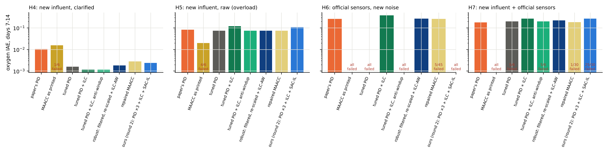

# Paper 1: two fixes and a second held-out test

Held-out test 1 (`docs/PAPER1_BASELINES_HELDOUT.md`) showed two flaws that
every design shared:

* the ILC made things worse when the aeration saturated;
* every high-gain controller failed with the official sensor noise.

Here both are fixed and tested on **new** data and noise. The protocol
(`docs/PAPER1_HELDOUT2_PROTOCOL.md`) and the frozen settings were pushed in
commit `378ac3d` before any run of this test. Numbers:
`results/paper1_heldout2_tables.json`.

## Step 1. Fix 1: ILC anti-windup

* The PID's limits move with the ILC feedforward, so PID + feedforward can
  reach either actuator limit and the PID never winds up.
* The ILC learns nothing from periods at a limit, and a day spent mostly at
  a limit keeps yesterday's profile.
* No tuning.

Built and checked on data already seen (held-out test 1, BSM2 window 245):
tuned PID + ILC went from 0.266 to 0.112, the same as the PID alone; normal
weather was unchanged.

## Step 2. Fix 2: robustness to sensor noise

The tuned PID + ILC with anti-windup, plus a first-order filter on the
oxygen measurement, with the gains of each loop scaled. Both were chosen on
dry week 1 with the official sensor models and noise seeds 100 and 101,
never used in a test (`experiments/42_robust_pid.py`).

A first search also filtered the nitrate loop and made it oscillate. It was
redone with the filter on oxygen only; both searches are kept.

Chosen: filter 0.75 min, gains ×0.5 on both loops.

On the official test week with ideal sensors (already seen), it reaches
−83 / −80 / −73 % oxygen against the paper's PID, **with the paper's
aeration movement** (522 against 501 for the paper's PID; 852 for the tuned
PID).

## Step 3. Held-out test 2

* **New BSM2 influent windows:** days 273–553, no overlap with test 1.
* **H4: after a simple primary clarifier.** The particulate components are
  halved. This brings the influent close to BSM1's: X_S 183 against about
  200 g/m³.
* **H5: the same windows raw.** The plant is overloaded, which tests the
  actuator limits.
* **H6: official dry, rain and storm files with the official sensors,** new
  noise seeds 10–12.
* **H7: H4 with the official sensors.**

Every run lasts 14 days and is scored on days 7–14 with the true
concentrations.

| Oxygen IAE, days 7–14 | H4: new influent | H5: overload | H6: official sensors | H7: new influent + sensors |
|---|---|---|---|---|
| Paper's PID | 0.0105 | 0.0815 | 0.261 | 0.178 |
| MAACC as printed | 0.0156 (1 of 6 failed) | 4 of 6 failed | all failed | all failed |
| Tuned PID | 0.0016 | 0.0737 | all failed | 5 of 6 failed |
| Tuned PID + ILC | 0.00115 | 0.120 | 0.382 | 0.267 |
| **Tuned PID + ILC, anti-windup** | **0.00115** | **0.0732** | all failed | 5 of 6 failed |
| **Robust** (filtered, ×0.5, ILC anti-windup) | 0.0018 | 0.0737 | 0.269 | 0.220 |
| Repaired MAACC | 0.0028 | 0.0749 | 0.262 (5 of 45 failed) | 0.187 (1 of 30 failed) |
| Ours, round 2 (PID ×3 + ILC + SAC-IL) | 0.0024 | 0.108 | all failed | 25 of 30 failed |



### Answers to the pre-declared questions

| Question | Result | Verdict |
|---|---|---|
| (i) Anti-windup better than no anti-windup under overload (H5)? | −39 %, better in 5 of 6 windows | **yes** |
| (i) and no worse on normal influent (H4)? | 0.0 % | **yes** |
| (ii) Robust has fewer failures than the paper's PID with the sensors (H6, H7)? | 0 and 0 failures each | no difference (neither failed) |
| (ii) Robust better than the paper's PID with the sensors? | H6 +3 %, H7 +24 %, better in 0 runs | **no** |
| (iii) Price of robustness on normal influent (H4), vs tuned PID + ILC with anti-windup | +60 % | reported |
| (iv) Robust better than the paper's PID on H4 and H5? | H4 −83 %, 6 of 6; H5 −10 %, 6 of 6 | **yes** |
| (v) Repaired MAACC better than the paper's PID? | H4 −73 %, H5 −8 %: yes; H6 +1 %, H7 +6 % (with failures): no | yes without sensors, no with them |

## Step 4. What this shows

* **Anti-windup works on new data.** Under overload it removes the ILC's
  harm (−39 %) and changes nothing on normal influent. With ideal
  sensors, that makes the ILC safe under overload (but see the next point).
* **Anti-windup is not enough with high gains and sensor noise.** The tuned
  PID + ILC fails every H6 run with anti-windup but none without it. With
  noise the loop hits the limits often, and anti-windup lets the high-gain
  PID push straight from one limit to the other. Anti-windup needs lower
  gains.
* **The robust controller never failed in this test** (nor did the paper's
  PID or the tuned PID + ILC without anti-windup). Of those three, it is the
  only one that is good in normal operation, under overload and with the
  sensors: −83 % on new normal influent, better than the paper's PID under
  overload, and no more aeration movement than the paper's PID. But with the official sensor noise it is **not better** than
  the paper's PID (+3 % and +24 %). We did not solve sensor noise: with
  0.25 g/m³ noise on a 2 mg/L set point, every PID-type controller here is
  noise-limited, and the paper's low gains are hard to beat.
* **Our round-2 controller is the least robust**: it fails all of H6 and 25
  of 30 runs of H7.
* **The repaired MAACC** generalises to the new influent (−73 % on H4) but
  not to sensor noise.

## Step 5. The claims now

1. Paper 1's MAACC does not work as printed: it fails every realistic
   held-out condition.
2. With repaired training it learns (−85 % in dry weather on the official
   data, −73 % on new influent), but it is not robust to sensor noise.
3. On nominal data, a tuned PID with our daily ILC is as good as any learner
   tried (−89 % against the paper's PID on new influent). With anti-windup
   it also handles overload.
4. Our robust variant (oxygen filter, lower gains, ILC with anti-windup)
   trades about 60 % of that nominal gain for never failing and for the
   paper's actuator movement. It is still −83 % on new influent, but only
   equal to or worse than the paper's PID under real sensor noise.
5. Under the official sensor noise, nothing we built beats the paper's PID.
   That is the open problem.

## Next steps

1. Sensor noise: model-based filtering (a Kalman filter or observer), or
   gain scheduling between the nominal and the robust gains on a noise
   estimate.
2. Train the repaired MAACC with the official sensor models in the loop.
3. Report both robust and nominal numbers as standard; a nominal-only test
   (as in paper 1) hides these failures.

## Reproduce

```bash
python experiments/42_robust_pid.py                                  # fix 2
python experiments/33_paper1_study.py --only PIDtuned+ILC-AW Robust  # official test week
python experiments/43_paper1_heldout2.py                             # held-out test 2 (432 runs)
python experiments/44_paper1_heldout2_doc.py                         # tables, figure, answers
```
