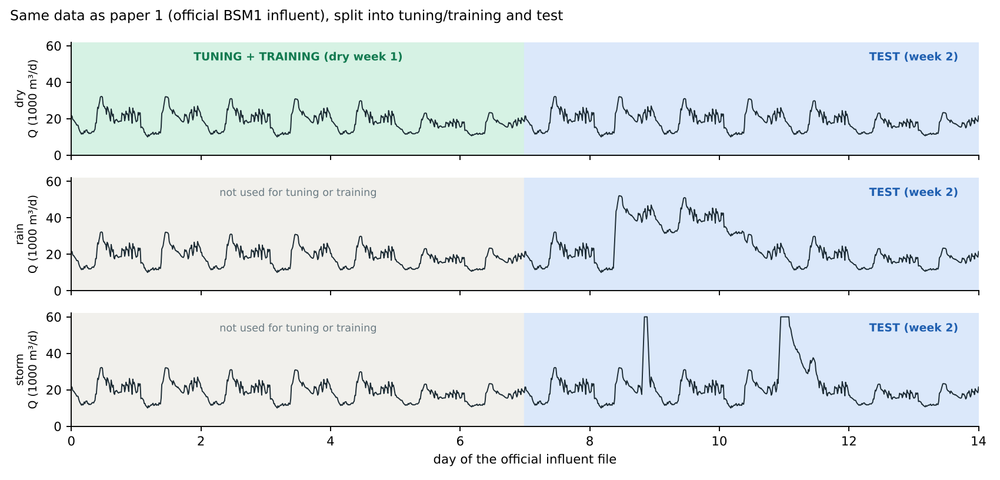
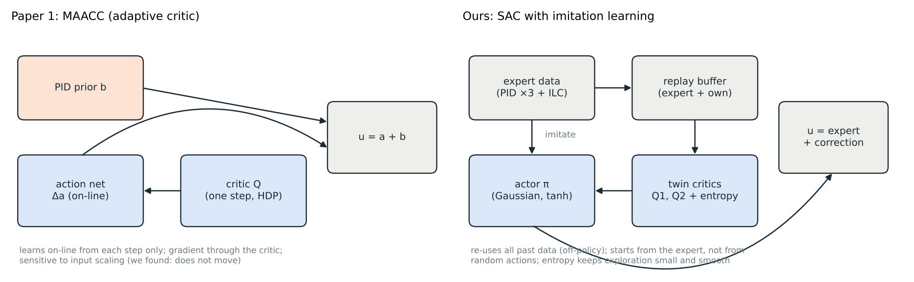
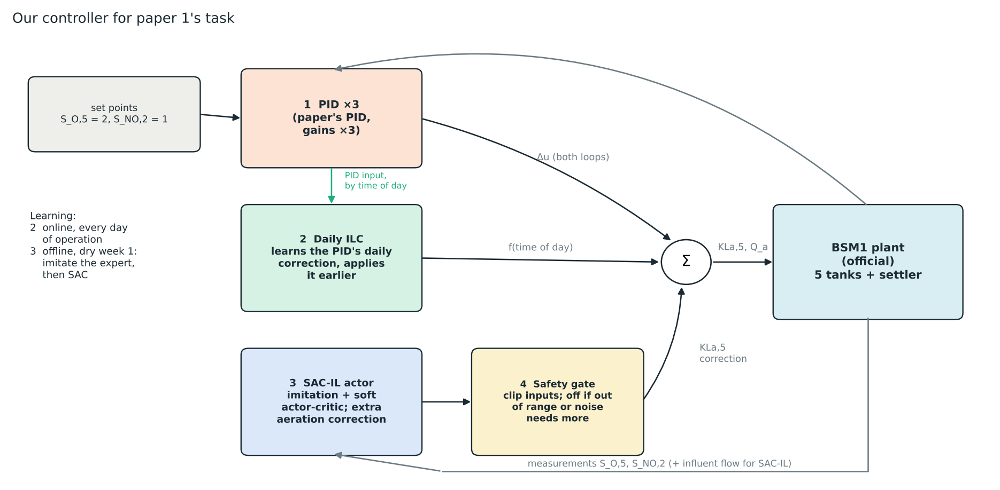
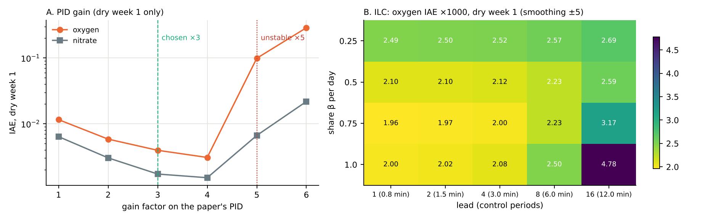
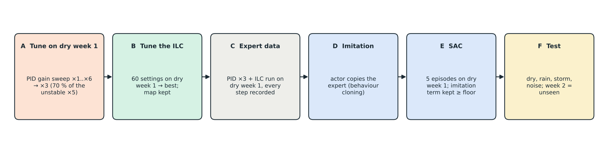
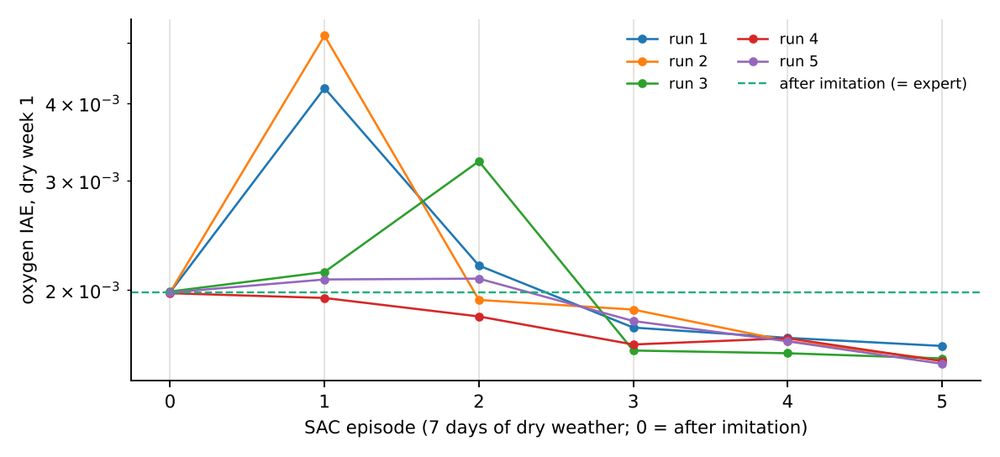
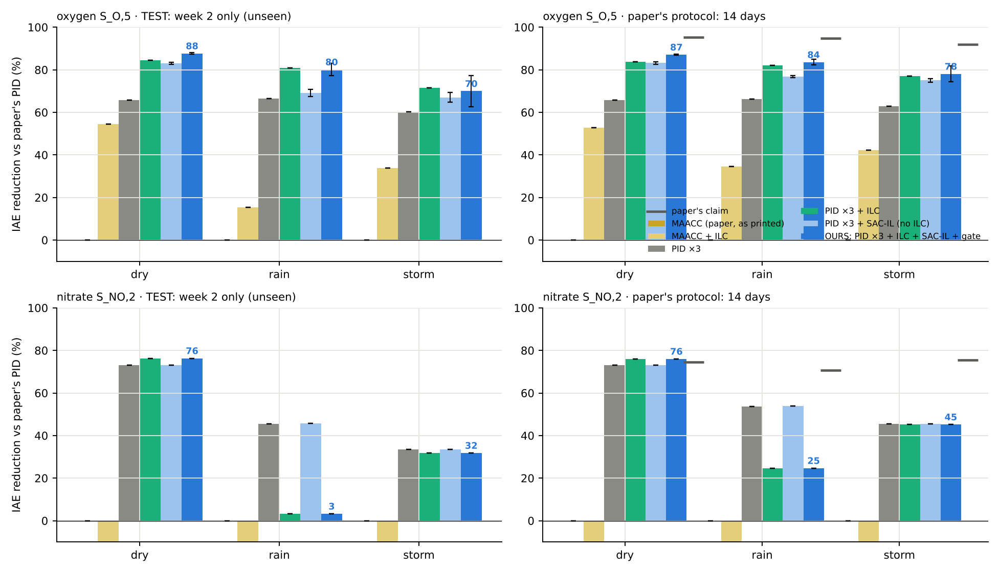
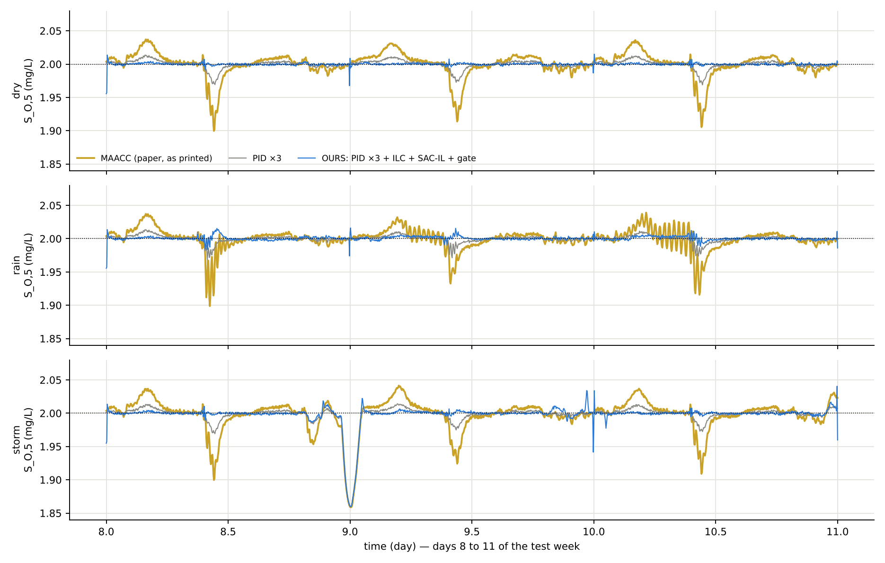
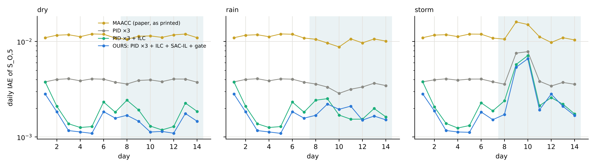
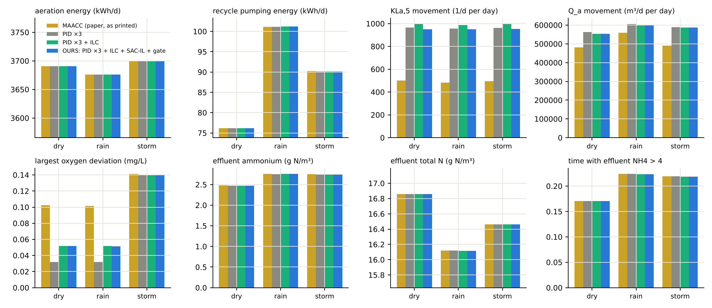

# Paper 1 study: base paper, reimplementation, and our controller

A step-by-step account, with figures, for discussion. Every number comes from
the result files of the repository (`results/summary_paper1_study.json`), and
every figure from the scripts named in each step.

**In one paragraph.** Paper 1 (MAACC) claims −92 to −95 % oxygen tracking
error against its PID. Rebuilt exactly as printed, MAACC equals its PID. Our
controller keeps the paper's expert PID and adds three things: a stronger
tuning, a daily iterative learning control (ILC) and a soft actor-critic
trained by imitation learning (SAC-IL), behind a safety gate. Tuned and trained
on one week of dry weather only, it reduces the oxygen error on the unseen
test week by **70–88 %** against the paper's PID (dry, rain, storm),
where MAACC gives 0 %. The reduction is real but smaller than the
paper's claim, and it has costs, listed in step 10.

---

## Step 1. The problem and the data

* **Plant.** BSM1, the IWA benchmark activated-sludge plant: two anoxic tanks,
  three aerated tanks, a secondary settler. We use the official code
  (bsm2-python 0.0.16).
* **Two loops, as in paper 1.** Oxygen in tank 5, S_O,5 → 2 mg/L, through the
  aeration KLa,5 (0–240 1/d). Nitrate in tank 2, S_NO,2 → 1 mg/L, through the
  internal recycle Q_a (0–92 230 m³/d). One control step every 45 s.
* **Data.** The same as paper 1: the official BSM1 influent files for dry,
  rain and storm weather, 14 days each, one sample every 15 minutes
  (paper 1, page 6, Section VI and Fig. 3).
* **Split.** Everything we tune or train uses **dry weather, week 1 only**.
  Week 2 of every weather is the **test**: never seen, and it holds the rain
  and storm events. We also give the paper's own score over 14 days.




## Step 2. What paper 1 proposes (MAACC)

Wang, Li, Ren, Qiao, *Multiagent Adaptive Critic Control With Expert Knowledge
for Wastewater Treatment Plants*, IEEE T-II 2026.

1. The plant is treated as two interconnected subsystems, one per loop.
2. One agent per subsystem, each with an action network and a critic network
   (adaptive dynamic programming / heuristic dynamic programming family).
3. The critic is a Q-function that also sees the other loop, so each agent
   accounts for the coupling.
4. **Expert knowledge:** a PID prior is part of the control law,
   u = a (learned) + b (PID), so the controller starts as the PID.
5. **Incremental control:** the action network outputs a change Δa, which is
   integrated, to resist disturbances.
6. A Lyapunov proof of stability; Table I gives every weight and rate.
7. **Claim (Table II):** oxygen error −95 / −95 / −92 % and nitrate error
   −75 / −71 / −76 % against the PID (dry / rain / storm); Table III with
   actuator noise.


## Step 3. Our reimplementation of paper 1

* Every equation and the Table I values implemented as printed
  (`src/wwtp/maacc/exact.py`), 20 runs per case.
* **Our PID matches the paper's PID:** dry oxygen IAE 0.0114 vs 0.0114. So the
  plant and the test are the same as the paper's.
* **MAACC as printed equals its PID** in all 80 runs (IAE within 1 %). With the
  printed weights the learning signal is about 10⁻⁴, and with learning rates
  0.01 and 0.005 the networks hardly move; twelve other initial weights either
  stay at the PID or diverge.
* The paper's set points are printed as [1, 2]; its figures and PID numbers
  only match the standard [2, 1], which we use.


## Step 4. Why SAC with imitation learning instead of the paper's training

The paper's learner is an on-line adaptive critic: it updates once per step
from that step alone, through the gradient of its own critic, starting from
small random weights. Our runs show it does not learn on this plant. Soft
actor-critic with imitation learning addresses each of these points.

| | Paper 1: adaptive critic (MAACC) | SAC with imitation learning |
|---|---|---|
| Data use | each step used once, then discarded | all past steps kept and re-used (replay, off-policy) |
| Start | small random weights next to a PID | the actor first copies the expert from recorded data |
| Expert knowledge | added to the output (u = a + b) | learned from demonstrations, and kept as a prior in the loop |
| Exploration | none planned | a small, controlled random part (entropy term) |
| Critic | one network, one-step target | two critics, the smaller value used (less over-estimation) |
| Scaling | sensitive: the learning signal was 10⁻⁴ | inputs and reward normalised |
| Safety on a real plant | learns while controlling from the start | trained on recorded expert data first; a gate falls back to the expert |

These are the reasons this choice fits the problem; check with your guide
which of them he had in mind.



## Step 5. Our controller



1. **PID ×3.** The paper's own PID, all gains ×3 (step 6).
2. **Daily ILC (the feedback-learning part).** About 96 % of the oxygen error
   left by the PID repeats every day: the PID reacts only after the daily load
   peak has moved the oxygen. The ILC stores, for every time of day, the
   correction the PID had to make, and each night takes over a share β of it,
   applied a little earlier (feedback-error learning). It learns on-line, from
   zero, while it controls. Settings from step 6: oxygen loop β =
   0.75, lead 1 step; nitrate loop β =
   0.25, lead 2 steps; smoothing ±5 steps.
   `src/wwtp/sacil/ilc.py`.
3. **SAC-IL correction (the guide's method).** A small actor network (inputs:
   last three errors of both loops, both inputs, influent flow) adds a bounded
   correction to the aeration. Trained by imitation of PID ×3 + ILC, then by
   soft actor-critic on dry week 1, with the imitation term kept above a floor.
   Only the aeration is corrected: when SAC also moved the recycle, it traded
   nitrate for oxygen. `src/wwtp/sacil/sacil.py`.
4. **Safety gate.** Inputs are clipped to the range seen in training. In any
   step where an input leaves that range by more than 10 %, or where the
   expert needs a larger correction than the learner may give (actuator
   noise), the learned part is switched off and PID ×3 + ILC act alone.

## Step 6. Tuning, on dry week 1 only

* Gain sweep ×1 … ×6: the loop becomes unstable at ×5; the
  rule (largest whole factor below 70 % of that) gives **×3**.
* ILC: 60 settings tried; the best is chosen. The map is flat: shares 0.75–1.0
  with leads up to 4 steps all give 1.96–2.08 ×10⁻³, so the result does not
  depend on a lucky setting. Long leads (16 steps) with a full share are
  worse, as expected.
* ILC on the nitrate loop: a small share (0.25) helps; larger shares or long
  leads make it worse.



## Step 7. Training



5 independent training runs, each: expert run on dry week 1 → imitation
(behaviour cloning) → critic warm-up → 5 SAC episodes of 7 days. The policy
kept is the best on the training week.



## Step 8. Results

Oxygen and nitrate IAE. Percentages are against the paper's PID (MAACC as
printed is equal to it). Learned controllers: mean of their runs
(5 for ours, 3 for MAACC and for SAC-IL without ILC).

**Test week (week 2, unseen), oxygen S_O,5**

| Controller | Dry | Rain | Storm |
|---|---|---|---|
| Paper's PID prior | 0.0113 | 0.0100 | 0.0120 |
| MAACC, paper 1 as printed | 0.0113 (0 %) | 0.0100 (0 %) | 0.0120 (0 %) |
| Paper's PID + our ILC | 0.0051 (−54 %) | 0.0085 (−15 %) | 0.0080 (−34 %) |
| MAACC + our ILC | 0.0051 (−54 %) | 0.0085 (−15 %) | 0.0080 (−34 %) |
| PID ×3 | 0.0039 (−66 %) | 0.0034 (−67 %) | 0.0048 (−60 %) |
| PID ×3 + ILC | 0.0017 (−85 %) | 0.0019 (−81 %) | 0.0034 (−72 %) |
| PID ×3 + SAC-IL (no ILC) | 0.0019 (−83 %) | 0.0031 (−69 %) | 0.0040 (−67 %) |
| Ours without the safety gate | 0.0014 (−87 %) | 0.0080 (−20 %) | 0.0076 (−37 %) |
| **Ours: PID ×3 + ILC + SAC-IL + gate** | 0.0014 (−88 %) | 0.0020 (−80 %) | 0.0036 (−70 %) |

**Test week, nitrate S_NO,2**

| Controller | Dry | Rain | Storm |
|---|---|---|---|
| Paper's PID prior | 0.0064 | 0.0151 | 0.0145 |
| MAACC, paper 1 as printed | 0.0064 (0 %) | 0.0151 (0 %) | 0.0145 (0 %) |
| Paper's PID + our ILC | 0.0109 (+72 %) | 0.0307 (+103 %) | 0.0184 (+27 %) |
| MAACC + our ILC | 0.0109 (+72 %) | 0.0307 (+103 %) | 0.0184 (+27 %) |
| PID ×3 | 0.0017 (−73 %) | 0.0082 (−46 %) | 0.0096 (−33 %) |
| PID ×3 + ILC | 0.0015 (−76 %) | 0.0146 (−3 %) | 0.0099 (−32 %) |
| PID ×3 + SAC-IL (no ILC) | 0.0017 (−73 %) | 0.0082 (−46 %) | 0.0096 (−34 %) |
| Ours without the safety gate | 0.0015 (−76 %) | 0.0139 (−8 %) | 0.0092 (−36 %) |
| **Ours: PID ×3 + ILC + SAC-IL + gate** | 0.0015 (−76 %) | 0.0146 (−3 %) | 0.0099 (−32 %) |

**Paper's protocol (14 days), oxygen**

| Controller | Dry | Rain | Storm |
|---|---|---|---|
| Paper's PID prior | 0.0114 | 0.0108 | 0.0118 |
| MAACC, paper 1 as printed | 0.0114 (0 %) | 0.0108 (0 %) | 0.0118 (0 %) |
| Paper's PID + our ILC | 0.0054 (−53 %) | 0.0070 (−35 %) | 0.0068 (−42 %) |
| MAACC + our ILC | 0.0054 (−53 %) | 0.0070 (−35 %) | 0.0068 (−42 %) |
| PID ×3 | 0.0039 (−66 %) | 0.0036 (−66 %) | 0.0044 (−63 %) |
| PID ×3 + ILC | 0.0019 (−84 %) | 0.0019 (−82 %) | 0.0027 (−77 %) |
| PID ×3 + SAC-IL (no ILC) | 0.0019 (−83 %) | 0.0025 (−77 %) | 0.0029 (−75 %) |
| Ours without the safety gate | 0.0015 (−87 %) | 0.0048 (−56 %) | 0.0046 (−61 %) |
| **Ours: PID ×3 + ILC + SAC-IL + gate** | 0.0015 (−87 %) | 0.0018 (−84 %) | 0.0026 (−78 %) |

**Dry weather with the paper's actuator noise (14 days), oxygen and nitrate**

| Controller | Dry + actuator noise |
|---|---|
| Paper's PID prior | 0.0249 |
| MAACC, paper 1 as printed | 0.0249 (0 %) |
| Paper's PID + our ILC | 0.0235 (−6 %) |
| MAACC + our ILC | 0.0235 (−6 %) |
| PID ×3 | 0.0185 (−26 %) |
| PID ×3 + ILC | 0.0183 (−27 %) |
| PID ×3 + SAC-IL (no ILC) | 0.0187 (−25 %) |
| **Ours: PID ×3 + ILC + SAC-IL + gate** | 0.0188 (−24 %) |

| Controller | Dry + actuator noise |
|---|---|
| Paper's PID prior | 0.0132 |
| MAACC, paper 1 as printed | 0.0132 (0 %) |
| Paper's PID + our ILC | 0.0217 (+65 %) |
| MAACC + our ILC | 0.0217 (+65 %) |
| PID ×3 | 0.0076 (−42 %) |
| PID ×3 + ILC | 0.0079 (−40 %) |
| PID ×3 + SAC-IL (no ILC) | 0.0076 (−42 %) |
| **Ours: PID ×3 + ILC + SAC-IL + gate** | 0.0078 (−41 %) |






**What each part adds (oxygen, test week, dry / rain / storm):**

* PID ×3: −66 % / −67 % / −60 %
* + daily ILC: −85 % / −81 % / −72 %
* + SAC-IL and the gate (ours): −88 % / −80 % / −70 %;
  that is −20 % / +4 % / +6 % against PID ×3 + ILC
* For a fair comparison, our ILC added to the paper's own MAACC gives
  −54 % / −15 % / −34 %.

## Step 9. Checking the feedback-learning part (ILC) and the gate

* **Sensitivity.** The tuning map (step 6) is flat around the chosen setting.
* **Learning over the days.** The daily error falls over the first days and
  stays low; weekends (lower load) and the storm days raise it, then it
  recovers. It never diverged in any run.
* **A bug we found and fixed.** In the noise test the earlier code dropped the
  ILC's feedforward before adding the noise; after the fix the ILC acts in
  every case. The earlier noise results were redone.
* **The nitrate ILC is not robust (a finding, not hidden).** Chosen on dry
  week 1, where it lowers the nitrate error, it makes nitrate worse in rain:
  test week 0.0146 with it against
  0.0082 for PID ×3 alone. The nitrate loop is fast, and
  a profile learned on dry days is wrong on rain days. A check made after
  seeing this (so not part of the main result): with the ILC on the oxygen
  loop only, nitrate returns to the PID ×3 level in rain
  (0.0082) while the oxygen stays as good
  (0.0019). But our SAC-IL policies, trained with
  the nitrate ILC in the loop, then lose their dry-weather gain (dry, test
  week, 0.0017 instead of 0.0014):
  a fair oxygen-only version needs SAC-IL retrained, which is the next step.
  On the paper's slower PID the same nitrate ILC is worse still (nitrate
  +72 / +103 / +27 % on the test week): its settings were tuned for PID ×3.
* **A second flaw: a jump at midnight.** The ILC replaces its whole profile
  once a day, at midnight, so the feedforward jumps a little at that moment.
  This causes the largest oxygen deviations of the ILC controllers: for ours,
  all ten largest deviations of the dry run are within 15 minutes of
  midnight (largest 0.052 mg/L, against
  0.032 for PID ×3); away from midnight our largest
  deviation is 0.025 mg/L, smaller than PID ×3's. The fix is simple (blend the
  old and new profile over the first hour of the day) and is listed as the
  next step, together with the oxygen-only ILC and retraining SAC-IL.
* **Gate.** On: 0.0% of the time in dry,
  13.1% in rain, 6.6%
  in storm, 51.0% with actuator noise. Without
  it, SAC-IL extrapolates in rain and storm (row "ours without the safety
  gate").



## Step 10. Trade-offs


**Dry weather (14 days)**

| | MAACC (paper) | PID ×3 | PID ×3 + ILC | Ours |
|---|---|---|---|---|
| Oxygen IAE, test week | 0.0113 | 0.0039 | 0.0017 | 0.0014 |
| Nitrate IAE, test week | 0.0064 | 0.0017 | 0.0015 | 0.0015 |
| Largest oxygen deviation (mg/L) | 0.102 | 0.032 | 0.052 | 0.052 |
| Largest nitrate deviation (mg/L) | 0.057 | 0.026 | 0.026 | 0.026 |
| Aeration energy (kWh/d) | 3690 | 3690 | 3690 | 3690 |
| Recycle pumping energy (kWh/d) | 76.2 | 76.1 | 76.1 | 76.1 |
| Aeration movement, KLa,5 (1/d per day) | 501 | 966 | 995 | 949 |
| Recycle movement, Q_a (m³/d per day) | 481,133 | 563,603 | 553,004 | 553,003 |
| Time with aeration at a limit | 0.0% | 0.0% | 0.0% | 0.0% |
| Time with recycle at a limit | 0.0% | 0.2% | 0.3% | 0.3% |
| Effluent ammonium (g N/m³) | 2.48 | 2.47 | 2.47 | 2.47 |
| Effluent total nitrogen (g N/m³) | 16.86 | 16.86 | 16.86 | 16.86 |
| Time with effluent NH4 > 4 | 17.1% | 17.1% | 17.1% | 17.1% |
| Time with effluent total N > 18 | 16.0% | 16.0% | 16.0% | 16.0% |
| Time the safety gate is on | 0.0% | 0.0% | 0.0% | 0.0% |

**Rain weather (14 days)**

| | MAACC (paper) | PID ×3 | PID ×3 + ILC | Ours |
|---|---|---|---|---|
| Oxygen IAE, test week | 0.0100 | 0.0034 | 0.0019 | 0.0020 |
| Nitrate IAE, test week | 0.0151 | 0.0082 | 0.0146 | 0.0146 |
| Largest oxygen deviation (mg/L) | 0.102 | 0.032 | 0.052 | 0.051 |
| Largest nitrate deviation (mg/L) | 0.483 | 0.479 | 0.721 | 0.722 |
| Aeration energy (kWh/d) | 3676 | 3676 | 3676 | 3676 |
| Recycle pumping energy (kWh/d) | 101.1 | 101.1 | 101.2 | 101.2 |
| Aeration movement, KLa,5 (1/d per day) | 483 | 957 | 986 | 951 |
| Recycle movement, Q_a (m³/d per day) | 559,335 | 606,021 | 601,089 | 601,136 |
| Time with aeration at a limit | 0.0% | 0.0% | 0.0% | 0.0% |
| Time with recycle at a limit | 1.4% | 2.1% | 2.2% | 2.2% |
| Effluent ammonium (g N/m³) | 2.76 | 2.76 | 2.76 | 2.76 |
| Effluent total nitrogen (g N/m³) | 16.12 | 16.12 | 16.12 | 16.12 |
| Time with effluent NH4 > 4 | 22.4% | 22.4% | 22.4% | 22.4% |
| Time with effluent total N > 18 | 13.0% | 13.0% | 12.9% | 12.9% |
| Time the safety gate is on | 0.0% | 0.0% | 0.0% | 13.1% |

**Storm weather (14 days)**

| | MAACC (paper) | PID ×3 | PID ×3 + ILC | Ours |
|---|---|---|---|---|
| Oxygen IAE, test week | 0.0120 | 0.0048 | 0.0034 | 0.0036 |
| Nitrate IAE, test week | 0.0145 | 0.0096 | 0.0099 | 0.0099 |
| Largest oxygen deviation (mg/L) | 0.141 | 0.140 | 0.140 | 0.140 |
| Largest nitrate deviation (mg/L) | 0.514 | 0.510 | 0.508 | 0.508 |
| Aeration energy (kWh/d) | 3700 | 3700 | 3701 | 3701 |
| Recycle pumping energy (kWh/d) | 90.2 | 90.2 | 90.2 | 90.2 |
| Aeration movement, KLa,5 (1/d per day) | 494 | 961 | 997 | 953 |
| Recycle movement, Q_a (m³/d per day) | 490,399 | 588,403 | 586,293 | 586,314 |
| Time with aeration at a limit | 0.7% | 0.7% | 0.8% | 0.8% |
| Time with recycle at a limit | 1.1% | 1.7% | 1.8% | 1.8% |
| Effluent ammonium (g N/m³) | 2.75 | 2.75 | 2.74 | 2.74 |
| Effluent total nitrogen (g N/m³) | 16.46 | 16.46 | 16.46 | 16.46 |
| Time with effluent NH4 > 4 | 21.9% | 21.9% | 21.9% | 21.9% |
| Time with effluent total N > 18 | 14.8% | 14.8% | 14.8% | 14.8% |
| Time the safety gate is on | 0.0% | 0.0% | 0.0% | 6.6% |

**Computing time per control step** (this machine, one core): paper's PID
5 µs; ILC 1 µs (including its
nightly update); SAC-IL actor 37 µs (18,564 weights);
MAACC 45 µs (it learns at every step). All far below the 45 s step.

**Training.** SAC-IL needs recorded expert data (7 days of the plant) and
about 15 minutes of computing per run here; MAACC learns on-line but did not
learn. The ILC needs no training, only a few days of operation.



**In words.**

* **Better:** oxygen tracking much better in every weather; aeration and
  pumping energy about the same; effluent quality about the same.
* **Costs:** the actuators move more (PID ×3 roughly doubles the aeration
  movement); the stability margin is smaller (×3 is 60 % of the unstable
  gain); the ILC relies on the daily repetition of the load; the learned part
  needs training data and a safety gate to stay reliable outside its training
  range, and its gain is mostly in the weather it was trained on; the ILC on
  the nitrate loop helps in dry weather but harms nitrate in rain, and the
  ILC's daily profile switch causes a short deviation at midnight that sets
  the largest oxygen deviation (step 9).

## Step 11. What we can claim

* On the official BSM1, with the paper's data, set points and metrics, our
  controller reduces the oxygen tracking error on unseen test data by
  **70–88 %** against the paper's PID and against MAACC as printed
  (which gives 0 %).
* Over the paper's 14-day protocol: 78–87 % on oxygen.
* Nitrate, test week: −76 % / −3 % / −32 % (dry / rain / storm); the
  small gain in rain is the nitrate ILC's fault (step 9).
* **The most robust part** is PID ×3 + the daily ILC on oxygen: −85 / −81 /
  −72 % on oxygen in the test week, with no learned network.
* What the guide's SAC-IL part adds on top of PID ×3 + ILC (oxygen, test
  week): −20 % in dry weather (the kind it was trained on),
  +4 % in rain and +6 % in the storm (a + sign means worse). On its own (without
  the ILC) it gives −83 % / −69 % / −67 %
  against the paper's PID, close to what the ILC gives alone.
* **Not claimed:** the paper's −92 to −95 %, which no setting the paper allows
  reproduces; a real-plant result; a gain under heavy actuator noise beyond
  the retuned PID.

## Next step (to make the feedback part clean)

1. Blend the ILC profile at midnight instead of switching (removes the jump).
2. ILC on the oxygen loop only (the nitrate ILC is not robust).
3. Retrain SAC-IL with that ILC in the loop, and test again on the same
   unseen week. About 1.5 hours of computing.

## Step 12. Questions to brainstorm

1. Should the ILC learn the weekly cycle (weekends) as well as the daily one?
2. Would SAC-IL gain more if it also saw the time of day or the ILC profile?
3. Can the gate be made smoother (blend instead of switch)?
4. How would the method behave on BSM2, or with sensor delay and noise?
5. Can the same scheme improve paper 2's energy saving while keeping the
   ammonium limit?
6. Which of the reasons in step 4 did the guide want to emphasise?

## Reproduce

```bash
python experiments/32_paper1_tuning.py            # step 6
python experiments/28_sac_il_paper1.py --seed 0 --episodes 5 --train-days 7 --noise-runs 0 --ilc --balanced --oxygen-only --tag sacil_v2   # seeds 0-4
python experiments/28_sac_il_paper1.py --seed 0 --episodes 5 --train-days 7 --noise-runs 0 --balanced --oxygen-only --tag sacil_noilc      # seeds 0-2
python experiments/33_paper1_study.py             # step 8: every controller, every case
python experiments/34_paper1_diagrams.py          # diagrams
python experiments/35_paper1_study_doc.py         # figures and tables
python experiments/37_paper1_posthoc_oxygen_ilc.py  # step 9, the after-the-fact check
python experiments/36_paper1_study_md.py          # this document
```
