# Reimplementing three reinforcement-learning controllers for wastewater treatment on the official BSM1 benchmark, and a retuned expert prior that improves on two of them

Amritha · 27 October 2026

## Abstract

Three recent papers control the Benchmark Simulation Model No. 1 (BSM1) with learning controllers built on a PID prior: a multiagent adaptive critic (paper 1), a DDPG agent that lets dissolved oxygen float (paper 2) and an integrated online Q-learning scheme (paper 3). We reimplemented all three exactly as printed on the official BSM1 plant with the official dry, rain and storm influent, and redrew every figure of the three papers from our runs. The plant and test conditions are largely confirmed: the oxygen-loop PID results of papers 1 and 3 and the PID energy of paper 2 are reproduced within 10 % (one case 16 %), while paper 1's nitrate-loop PID error comes out about half the published value. The learning controllers are not reproduced: paper 1's controller stays equal to its PID prior (IAE within 1 %) in 80 of 80 runs, and paper 3's is unstable as printed; paper 2's DDPG reproduces the direction of its energy saving, but with more ammonium and a wide spread between seeds. We show that the PID prior used by papers 1 and 3 is weakly tuned: raising its gain, with the factor chosen on dry weather only and a margin from the stability limit, reduces the tracking error by 63–66 % (paper 1, oxygen) and 64–74 % (paper 3) in every weather, including conditions not used for the choice. For paper 2, our constrained agent held to the PID's own compliance does not improve on the PID; we report this negative result.

## 1. The three base papers

> **Paper 1. Multiagent Adaptive Critic Control With Expert Knowledge for Wastewater Treatment Plants**  
> D. Wang, X. Li, J. Ren, J. Qiao. IEEE Transactions on Industrial Informatics, 2026, doi:10.1109/TII.2026.3659924

> **Paper 2. Dissolved oxygen concentration control in wastewater treatment process based on reinforcement learning**  
> S. L. Du, P. X. Chen, H. G. Han, J. F. Qiao. Science China Technological Sciences 66(9), 2549–2560, 2023, doi:10.1007/s11431-022-2403-8

> **Paper 3. Integrated Online Q-Learning Design for Wastewater Treatment Processes**  
> M. Zhao, D. Wang, J. Ren, J. Qiao. IEEE Transactions on Industrial Informatics 21(2), 1833–1842, 2025, doi:10.1109/TII.2024.3488790

## 2. What was done

- Implemented each algorithm exactly as printed, with every value given in the paper.
- Ran each paper's own experiments on the official BSM1 plant (the bsm2-python port of the IWA benchmark code) with the official dry, rain and storm influent files.
- Redrew every figure of the three papers (24 in all) from these runs and compared every results table with ours.
- Tested an improved controller for each paper under identical conditions.

Common protocol: 14 days at 45 s control periods (26 880 periods); before each run the plant runs 14 days on dry weather under the paper's PID, so every controller starts from the same state; IAE = mean|e|, ISE = mean e², DEVmax = max|e|. Repeated runs differ only in the network initialisation (and the noise sequence). The plant, the data and every setting are listed in Appendix A; the code in Appendix B.

## 3. Paper 1

> **Paper 1. Multiagent Adaptive Critic Control With Expert Knowledge for Wastewater Treatment Plants**  
> D. Wang, X. Li, J. Ren, J. Qiao. IEEE Transactions on Industrial Informatics, 2026, doi:10.1109/TII.2026.3659924

Method. Two agents, one per loop (KLa,5 → S_O,5 and Q_a → S_NO,2), each with an action network Δa = π(z) and a critic Q(z, Δa, a). The applied input is u = a + b, where b is an incremental PID (Kp = diag(100, 100 000), Ki = diag(20, 30 000), Kd = diag(10, 1000)) and a = a + Δa. Table I of the paper gives every weight, learning rate and network size; we used them unchanged.

A discrepancy in the paper. The text gives set points r = [1, 2] for [S_O,5, S_NO,2], but Figs. 4–6 and 8 show S_O,5 held at 2 and S_NO,2 at 1. With [2, 1] our PID reproduces the paper's PID oxygen results (dry IAE 1.140·10⁻² against 1.14·10⁻²); with [1, 2] it does not. We use [2, 1]. Our nitrate-loop PID error is about half the paper's in every weather; the paper's nitrate controller, sensor or actuator must differ from what the text describes, and we could not find what.

### 3.1 Figures: published and reimplemented

**Fig. 1. Structural diagram of the WWTP based on the activated sludge process.**

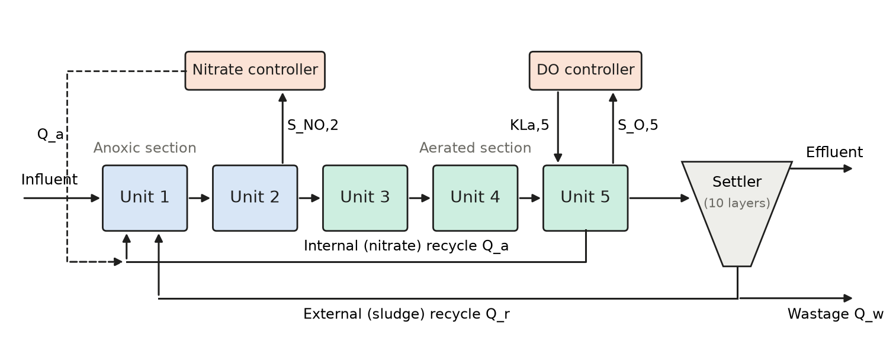

Redrawn. Same plant, sensors and the two manipulated inputs (KLa,5 and Q_a).
*The published figure is in the paper (not reproduced here for copyright reasons).*

**Fig. 2. Frame diagram of the MAACC algorithm.**

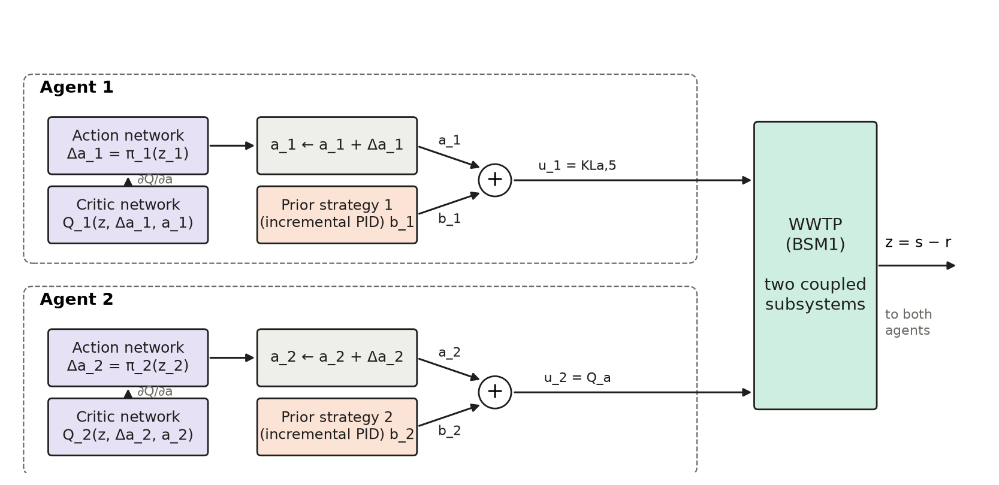

Redrawn. Each agent: action network giving Δa, critic Q(z, Δa, a), integrator a = a + Δa, and the PID prior b; u = a + b.
*The published figure is in the paper (not reproduced here for copyright reasons).*

**Fig. 3. Influent flow rates of the WWTP under dry, rainy and stormy weather conditions.**

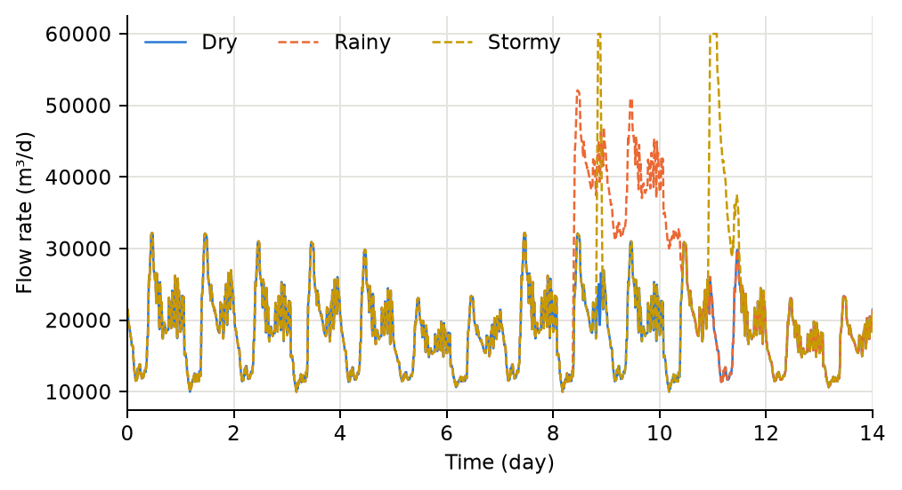

Official BSM1 influent files. Matches the published figure, including the rain period (days 8.4–10.4) and the two storm peaks of 60 000 m³/d.
*The published figure is in the paper (not reproduced here for copyright reasons).*

**Fig. 4. Trajectories of S_O,5 and S_NO,2 under the dry weather.**

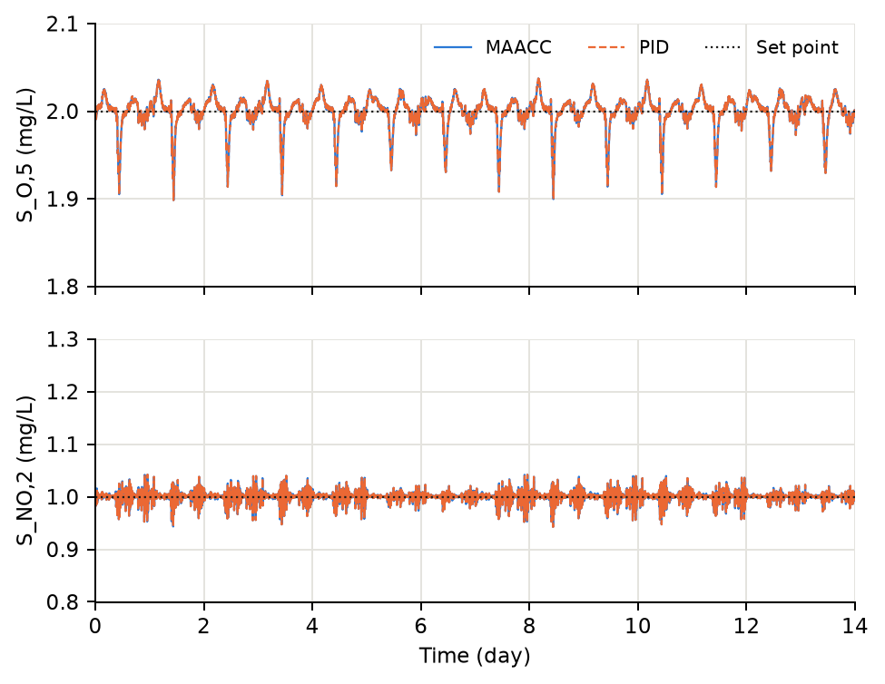

Our PID oxygen trace has the same shape and size as the paper's (dry weather); our nitrate error is about half the paper's. Our MAACC, exactly as printed, lies on top of the PID line: in all three weathers the learned correction changes the inputs by at most 0.6 d⁻¹ on KLa,5 and 10 m³/d on Q_a (well under 1 %). The paper's MAACC trace is almost flat at the set point; we could not obtain that. Dry-weather PID oxygen IAE: ours 1.14·10⁻², paper 1.14·10⁻².
*The published figure is in the paper (not reproduced here for copyright reasons).*

**Fig. 5. Trajectories of S_O,5 and S_NO,2 under the rainy weather.**

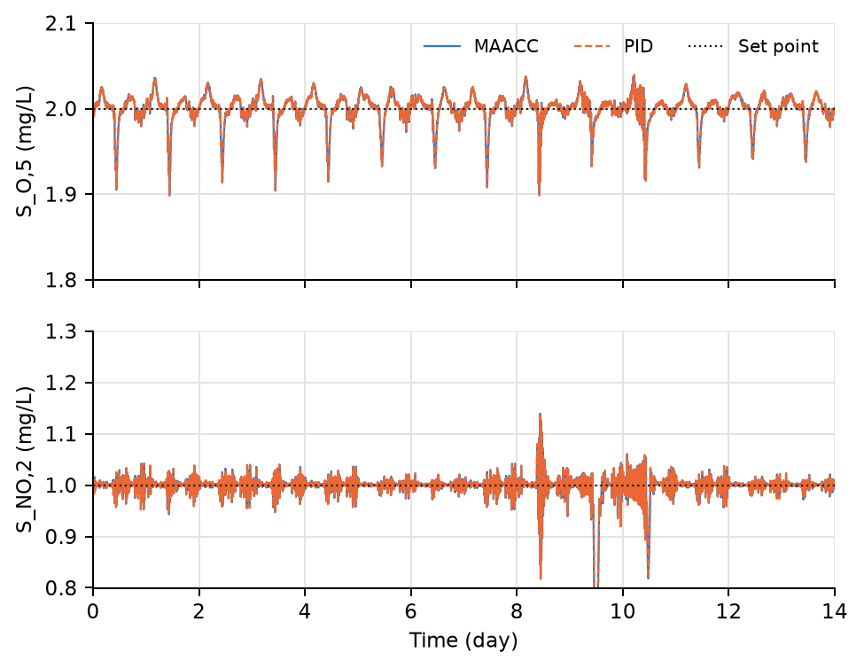

Our PID oxygen trace has the same shape and size as the paper's (rainy weather); our nitrate error is about half the paper's. Our MAACC, exactly as printed, lies on top of the PID line: in all three weathers the learned correction changes the inputs by at most 0.6 d⁻¹ on KLa,5 and 10 m³/d on Q_a (well under 1 %). The paper's MAACC trace is almost flat at the set point; we could not obtain that.
*The published figure is in the paper (not reproduced here for copyright reasons).*

**Fig. 6. Trajectories of S_O,5 and S_NO,2 under the stormy weather.**

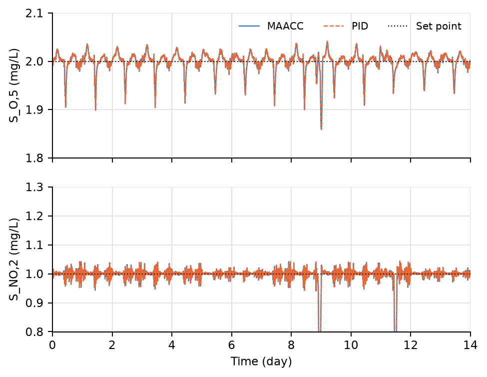

Our PID oxygen trace has the same shape and size as the paper's (stormy weather); our nitrate error is about half the paper's. Our MAACC, exactly as printed, lies on top of the PID line: in all three weathers the learned correction changes the inputs by at most 0.6 d⁻¹ on KLa,5 and 10 m³/d on Q_a (well under 1 %). The paper's MAACC trace is almost flat at the set point; we could not obtain that.
*The published figure is in the paper (not reproduced here for copyright reasons).*

**Fig. 7. Trajectories of KLa,5 and Q_a under different weather conditions.**

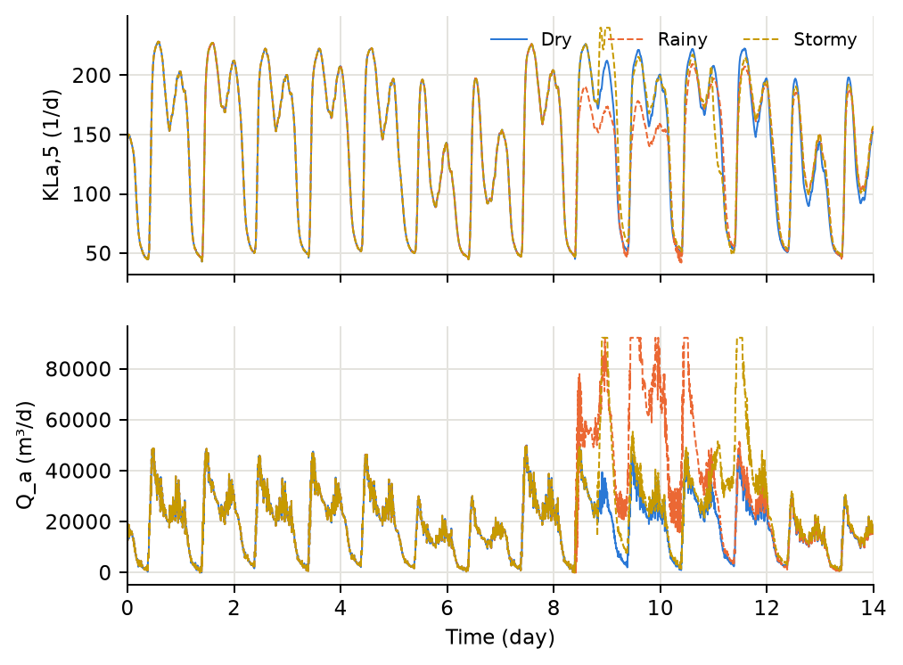

Same daily pattern and range of KLa,5 and Q_a; in rain and storm Q_a rises towards its upper limit during the high flows, as in the paper.
*The published figure is in the paper (not reproduced here for copyright reasons).*

**Fig. 8. Trajectories of S_O,5 and S_NO,2 under the dry weather and the control input noise.**

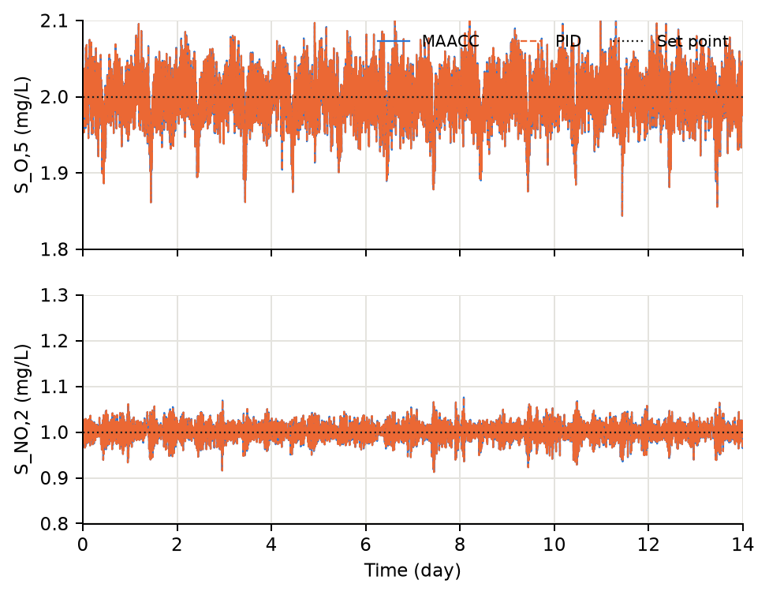

With the stated actuator noise our PID error grows about two-fold (oxygen IAE 2.49·10⁻²); the paper's PID changes very little (1.25·10⁻²). MAACC again equals PID.
*The published figure is in the paper (not reproduced here for copyright reasons).*

**Fig. 9. Trajectories of KLa,5 and Q_a under dry weather.**

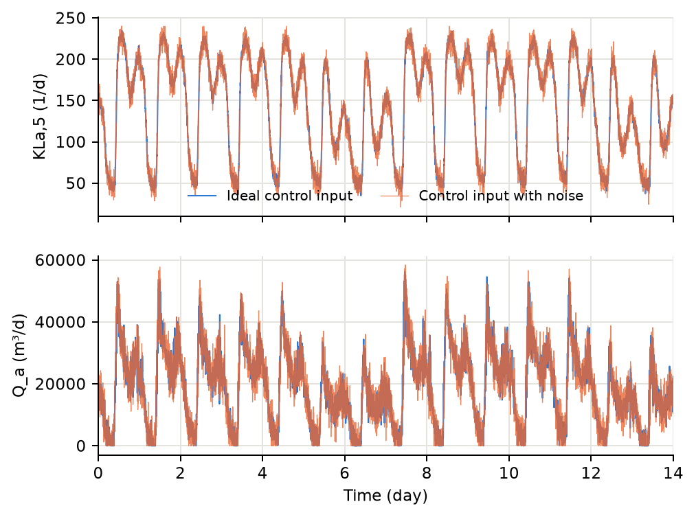

Ideal and noisy inputs of the same run; same appearance as the paper's figure.
*The published figure is in the paper (not reproduced here for copyright reasons).*

### 3.2 Tables II and III against our reimplementation

| Case | Method | IAE S_O,5 paper | IAE S_O,5 ours | IAE S_NO,2 paper | IAE S_NO,2 ours |
|---|---|---|---|---|---|
| Dry | PID (paper's prior) | 0.0114 | 0.0114 | 0.0145 | 0.00635 |
|  | MAACC | 0.000527 | 0.0114 | 0.0037 | 0.00635 |
| Rain | PID (paper's prior) | 0.0098 | 0.0108 | 0.0204 | 0.0107 |
|  | MAACC | 0.000509 | 0.0108 | 0.006 | 0.0107 |
| Storm | PID (paper's prior) | 0.0117 | 0.0118 | 0.0196 | 0.0104 |
|  | MAACC | 0.000947 | 0.0118 | 0.0048 | 0.0104 |
| Dry + noise | PID (paper's prior) | 0.0125 | 0.0249 | 0.0245 | 0.0132 |
|  | MAACC | 0.0017 | 0.0249 | 0.0077 | 0.0132 |

*Ours: mean of 20 runs.*

Result: not reproduced. Run as printed, MAACC stays equal to its PID prior in all 80 runs (IAE within 0.8 %). With the Table I weights in raw units the utility is about 10⁻⁴, so at lc = 0.01 and la = 0.005 neither network moves (the inputs change by under 1 %). Twelve other initial weight scales, the only setting the paper leaves open, either leave it equal to PID or make it diverge. Under the stated actuator noise our PID error roughly doubles, whereas the paper's barely changes, so that experiment cannot be matched.

### 3.3 Our improvement: a retuned expert prior

The learned correction in paper 1 is meant to improve on the PID prior. On the official plant the prior itself has large headroom: scaling all its gains by a factor g reduces the error until the oxygen loop enters a limit cycle at g = 5 (dry weather). We choose g = 3, the largest step below 70 % of that limit, on dry weather only, and apply it unchanged to rain, storm and the noise test.

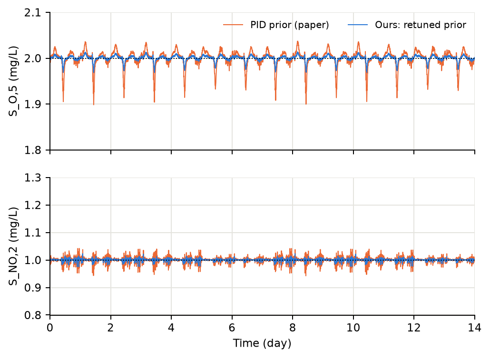

*Paper 1 set-up, dry weather: the paper's PID prior and our retuned prior.*

| Case | S_O,5: PID | MAACC (reimpl.) | Ours | S_NO,2: PID | MAACC (reimpl.) | Ours |
|---|---|---|---|---|---|---|
| Dry | 0.0114 | 0.0114 | 0.0039 (−66 %) | 0.00635 | 0.00635 | 0.00171 (−73 %) |
| Rain | 0.0108 | 0.0108 | 0.00364 (−66 %) | 0.0107 | 0.0107 | 0.00497 (−54 %) |
| Storm | 0.0118 | 0.0118 | 0.00437 (−63 %) | 0.0104 | 0.0104 | 0.00567 (−46 %) |
| Dry + noise | 0.0249 | 0.0249 | 0.0185 (−26 %) | 0.0132 | 0.0132 | 0.00765 (−42 %) |

*IAE. Percentages: reduction relative to the paper's PID prior. Noise case: mean of 20 noise sequences. The gain was chosen on dry weather, so rain, storm and noise are unseen conditions.*

## 4. Paper 2

> **Paper 2. Dissolved oxygen concentration control in wastewater treatment process based on reinforcement learning**  
> S. L. Du, P. X. Chen, H. G. Han, J. F. Qiao. Science China Technological Sciences 66(9), 2549–2560, 2023, doi:10.1007/s11431-022-2403-8

Method. A DDPG agent changes KLa,5 directly, with no DO set point, using the state [S_S,5, S_O,5, S_NH,5] and two rewards: A penalises effluent limit violations, B adds aeration energy. The agent learns on week 1 and is evaluated on week 2 against a PID (DO = 2 mg/L) and a fuzzy controller. The published networks (3-256-256-1) and hyperparameters (γ 0.99, batch 256, τ 0.001, learning rates 10⁻⁴ and 3·10⁻⁴) are used. Three corrections are applied because, as published, the agent did not learn reliably on our first plant: the actuator setting is added to the state, each action is held 15 minutes, and the reward is scaled by 1 − γ. Run exactly as published (one seed, dry) on the official plant, it shuts the air almost off during training and ends at a similar 10.7 % saving.

### 4.1 Figures: published and reimplemented

**Fig. 1. The overall layout of BSM1.**


Redrawn BSM1 layout with the DO loop.
*The published figure is in the paper (not reproduced here for copyright reasons).*

**Fig. 2. RL-based control framework.**

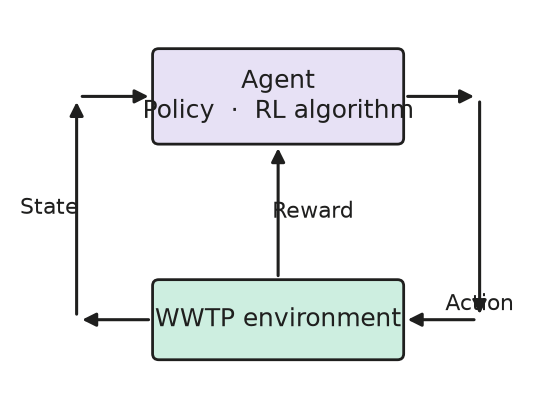

Redrawn agent–environment loop.
*The published figure is in the paper (not reproduced here for copyright reasons).*

**Fig. 3. Structure of the DDPG-based control strategy.**

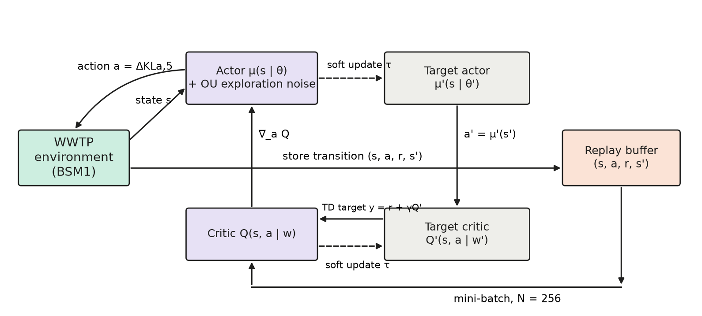

Redrawn DDPG structure: actor, critic, target networks, replay buffer, soft updates.
*The published figure is in the paper (not reproduced here for copyright reasons).*

**Fig. 4. Changes of effluent parameters when the S_O,5 set point value changes.**

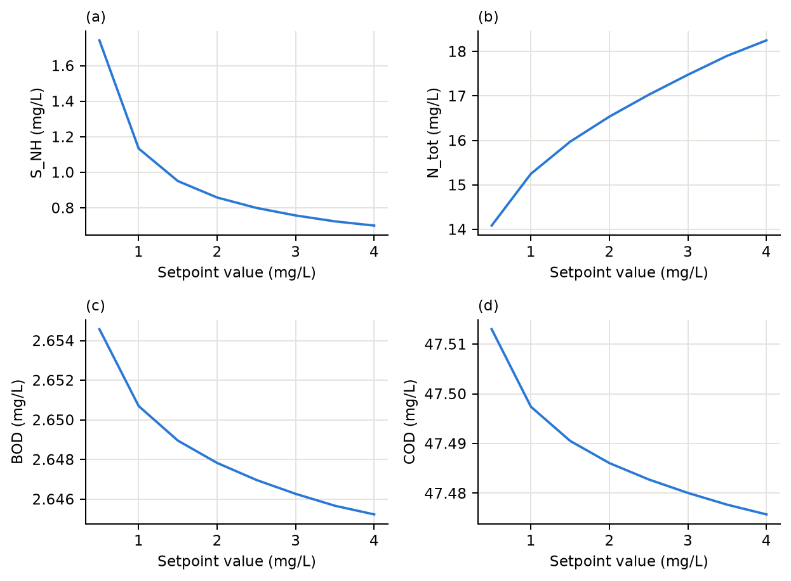

Constant average influent, DO held at each set point for 40 days. Same trends: ammonium falls and total nitrogen rises with DO; BOD and COD hardly change. Our ammonium curve is flatter than the paper's at low DO, i.e. our plant is less sensitive to under-aeration.
*The published figure is in the paper (not reproduced here for copyright reasons).*

**Fig. 5. Structure of neural network.**

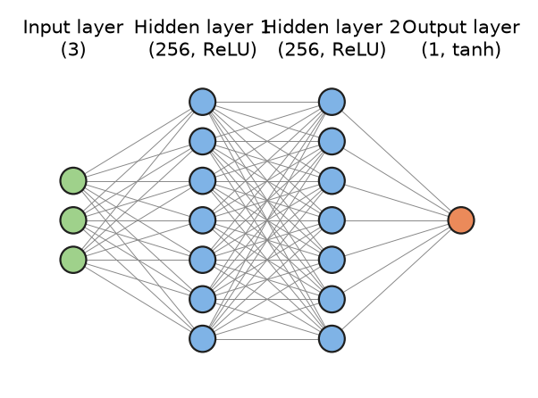

Redrawn network: 3 inputs, two hidden layers of 256 ReLU units, one tanh output.
*The published figure is in the paper (not reproduced here for copyright reasons).*

**Fig. 6. The control results of S_O,5 under four dissimilar control strategies in rain weather.**

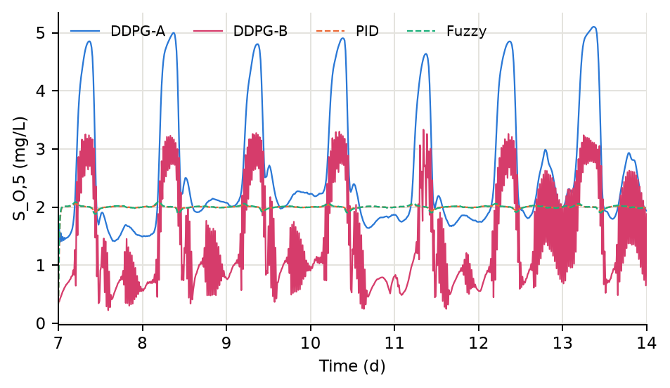

PID and fuzzy hold 2 mg/L as in the paper. Both DDPG agents lower the DO between load peaks, as in the paper, but our runs are rougher: DDPG-B switches quickly, and DDPG-A over-aerates at the daily peaks.
*The published figure is in the paper (not reproduced here for copyright reasons).*

**Fig. 7. Comparisons of several important effluent components under four dissimilar control strategies in the rain weather.**

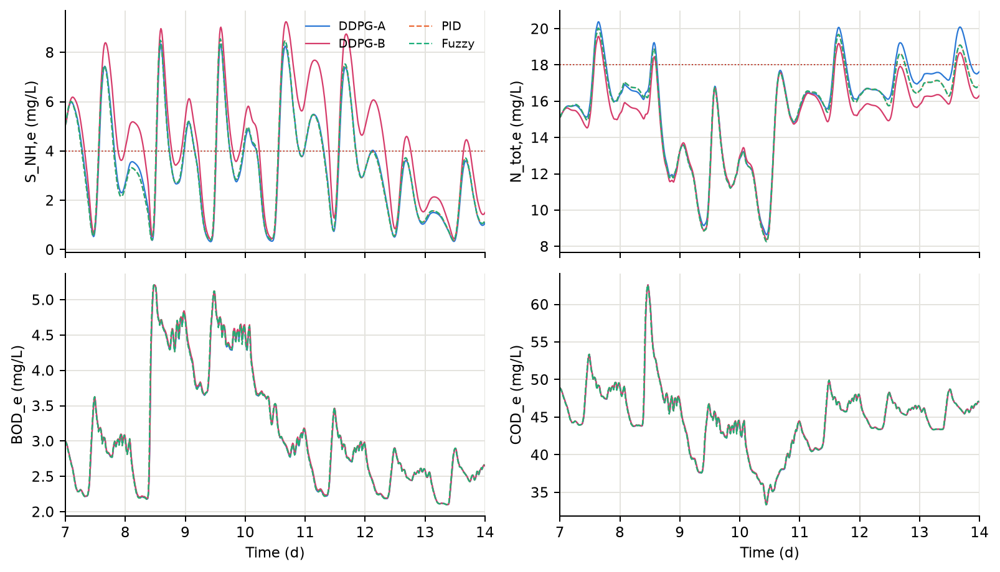

Same ordering as the paper: DDPG lowers total nitrogen and raises ammonium; BOD and COD are almost the same for all four controllers.
*The published figure is in the paper (not reproduced here for copyright reasons).*

**Fig. 8. (a) The control results of S_O,5 in the dry weather; (b) in the storm weather.**

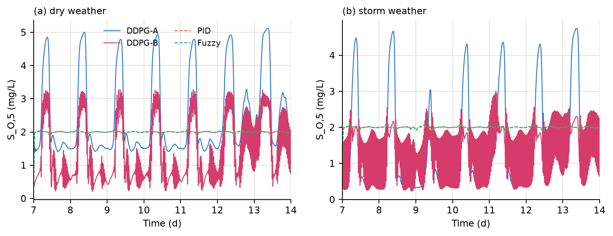

Dry and storm weather; same behaviour as in rain.
*The published figure is in the paper (not reproduced here for copyright reasons).*

### 4.2 Tables 2–4 against our reimplementation

| Weather | Method | AE paper | AE ours | Saving % paper | Saving % ours | S_NH,e paper | S_NH,e ours | EQ paper | EQ ours |
|---|---|---|---|---|---|---|---|---|---|
| Dry | PID | 3698 | 3728 | 0.0 | 0.0 | 2.34 | 2.81 | 6226 | 6196 |
|  | Fuzzy | 3697 | 3728 | 0.0 | -0.0 | 2.33 | 2.81 | 6222 | 6197 |
|  | DDPG-A | 3556 | 3692 | 3.8 | 1.0 | 2.65 | 3.28 | 6069 | 6305 |
|  | DDPG-B | 3430 | 3378 | 7.2 | 9.4 | 3.26 | 4.75 | 6073 | 6638 |
| Rain | PID | 3666 | 3691 | 0.0 | 0.0 | 2.88 | 3.40 | 8220 | 8293 |
|  | Fuzzy | 3665 | 3691 | 0.0 | -0.0 | 2.87 | 3.40 | 8211 | 8294 |
|  | DDPG-A | 3584 | 3597 | 2.2 | 2.6 | 3.11 | 4.14 | 8147 | 8552 |
|  | DDPG-B | 3463 | 3449 | 5.5 | 6.5 | 3.65 | 4.62 | 8242 | 8680 |
| Storm | PID | 3714 | 3743 | 0.0 | 0.0 | 2.83 | 3.31 | 7237 | 7253 |
|  | Fuzzy | 3713 | 3743 | 0.0 | -0.0 | 2.82 | 3.31 | 7230 | 7254 |
|  | DDPG-A | 3726 | 3828 | -0.3 | -2.3 | 2.92 | 3.69 | 7123 | 7427 |
|  | DDPG-B | 3489 | 3442 | 6.1 | 8.0 | 3.60 | 4.94 | 7250 | 7710 |

*AE in kWh/d, S_NH,e in g N/m³, evaluation week. DDPG rows: mean of 4 runs (dry, rain) and 2 runs (storm).*

Result: reproduced in direction. PID and fuzzy match the paper within about 1 % on energy and effluent index, and DDPG-B saves energy in every weather, as in the paper. The size differs: our DDPG-B saves more and lets ammonium rise more, and the spread between seeds is large (dry: 5.6–15.7 %). The paper reports one value per case without seeds. Not reported by the paper: with DDPG-B the effluent ammonium is above its 4 g N/m³ limit 54 % of the dry week, against 21 % with the PID.

### 4.3 Our attempt at an improvement: an agent held to the PID's own compliance

Our agent (PANDA-RL: an influent forecast as input, a critic that optimises the worst 30 % of outcomes, and Lagrange multipliers that hold the share of time above the ammonium and total nitrogen limits to a budget) is given budgets close to the PID's own violation rates in dry weather (PID: ammonium 21 %, total nitrogen 18 % of the week; budgets used: 20 % and 18 %).

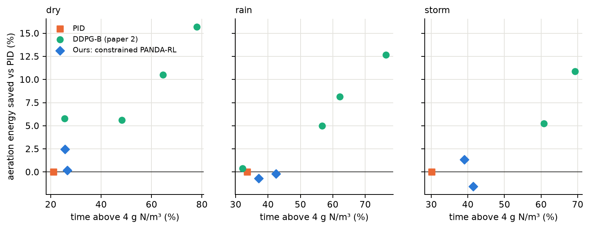

*Energy saved against the share of the evaluation week above the 4 g N/m³ ammonium limit; each point is one run.*

| Weather | Method | Energy saved vs PID (%) | Time NH4 > 4 (%) | Time N_tot > 18 (%) | EQ |
|---|---|---|---|---|---|
| Dry | PID | 0.0 | 21 | 18 | 6196 |
|  | DDPG-B (paper 2) | 9.4 | 54 | 9 | 6638 |
|  | Ours: constrained PANDA-RL | 1.3 | 26 | 15 | 6237 |
| Rain | PID | 0.0 | 34 | 12 | 8293 |
|  | DDPG-B (paper 2) | 6.5 | 57 | 6 | 8680 |
|  | Ours: constrained PANDA-RL | -0.4 | 40 | 10 | 8349 |
| Storm | PID | 0.0 | 30 | 15 | 7253 |
|  | DDPG-B (paper 2) | 8.0 | 65 | 8 | 7710 |
|  | Ours: constrained PANDA-RL | -0.1 | 40 | 14 | 7393 |

*Means of runs (ours: 2 per weather).*

Result: no improvement. Held to the PID's compliance, the agent stays close to the PID: it saves at most 2.5 % energy (dry) and in rain and storm none, while still breaking the ammonium limit somewhat more often than the PID (26–42 % of the week against 21–34 %). DDPG-B's larger savings are bought with roughly twice the PID's violations. On the official plant we therefore have no controller that saves energy at the PID's compliance.

## 5. Paper 3

> **Paper 3. Integrated Online Q-Learning Design for Wastewater Treatment Processes**  
> M. Zhao, D. Wang, J. Ren, J. Qiao. IEEE Transactions on Industrial Informatics 21(2), 1833–1842, 2025, doi:10.1109/TII.2024.3488790

Method. u = ω·α(e) + β(e): a PID prior α (Kp = 100, Ki = 20, Kd = 1) plus an action network β, both included in the critic Q(e, u); utility e² + 0.01u², γ = 1, 15 hidden units, lc = 0.01, la = 0.005, 50 critic and 60 action-network training steps per period. Fixed (r = 2 mg/L) and dynamic (2 / 2.2 / 1.8 mg/L) references; priors K1–K3 with ω = 0.99^k.

### 5.1 Figures: published and reimplemented

**Fig. 1. Activated sludge method in the BSM1 platform.**

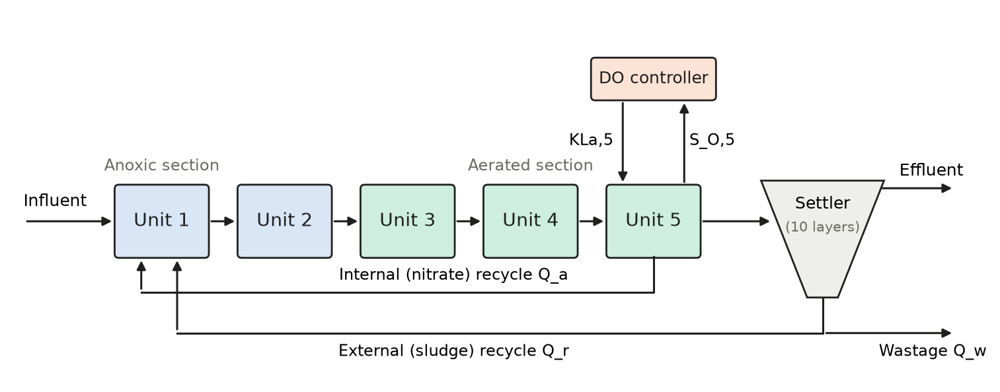

Redrawn BSM1 layout with the DO loop.
*The published figure is in the paper (not reproduced here for copyright reasons).*

**Fig. 2. Diagram of the IOQL framework.**

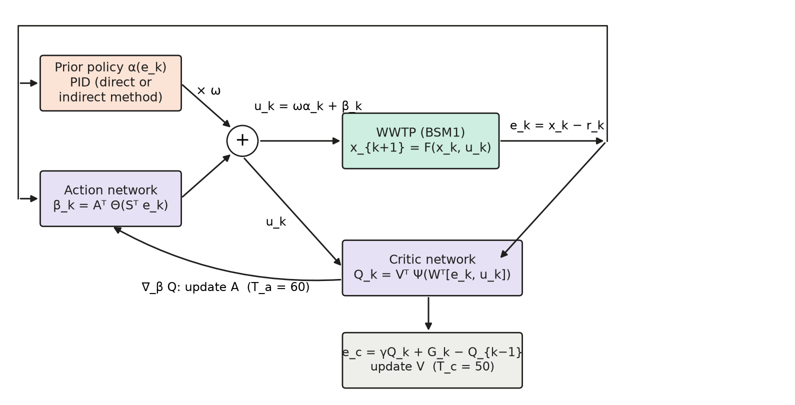

Redrawn IOQL framework: prior policy, action network, plant, critic and the two update loops.
*The published figure is in the paper (not reproduced here for copyright reasons).*

**Fig. 3. Inflow data in three weather conditions.**

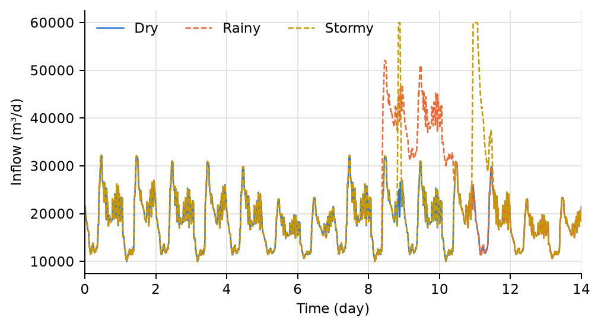

Official influent files; matches the published figure.
*The published figure is in the paper (not reproduced here for copyright reasons).*

**Fig. 4. Trajectories of S_O,5 under IOQL and PID methods and the fixed r_k. (a) Dry. (b) Rain. (c) Rainstorm.**

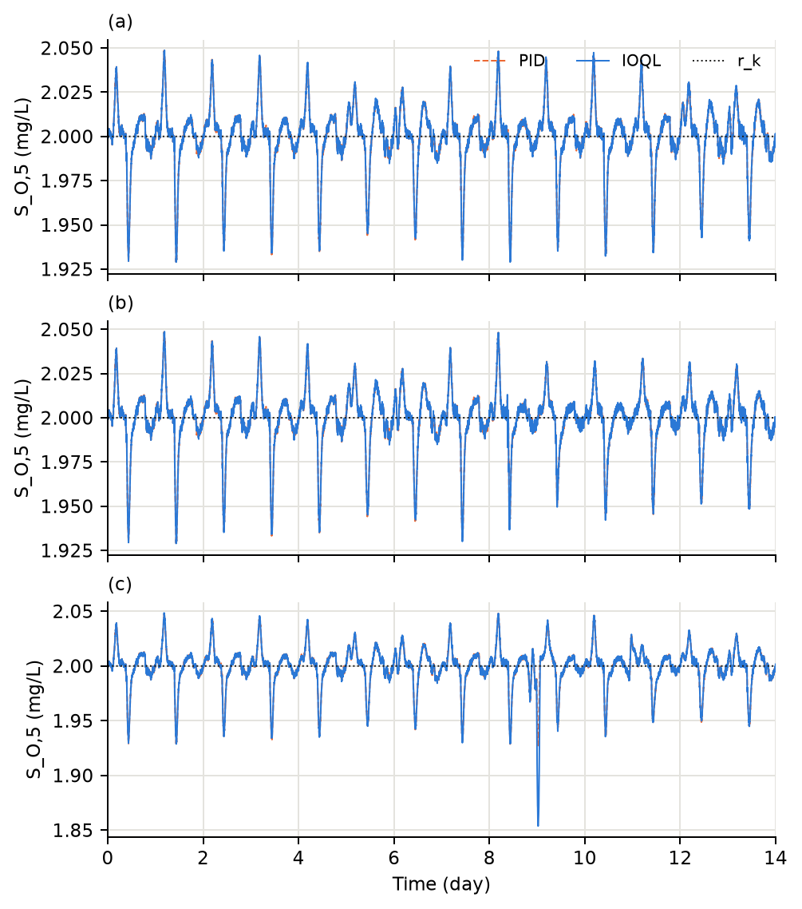

Our PID matches the paper (dry IAE 1.13·10⁻² against 1.16·10⁻²). Our IOQL seed 0 stays on the PID line; the other two seeds drive the aeration down and S_O,5 collapses (not shown on this scale).
*The published figure is in the paper (not reproduced here for copyright reasons).*

**Fig. 5. Trajectories of S_O,5 under IOQL with different prior policies and the fixed r_k.**

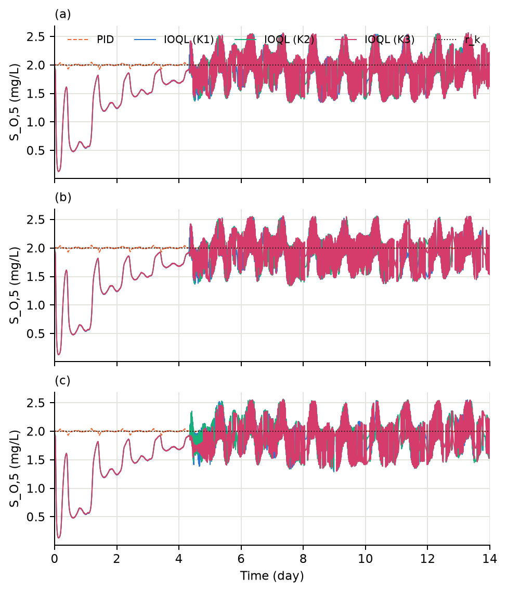

With ω = 0.99^k the prior fades within hours and the action network alone does not hold the set point: S_O,5 first collapses, then swings between about 1.5 and 2.5 mg/L.
*The published figure is in the paper (not reproduced here for copyright reasons).*

**Fig. 6. Trajectories of S_O,5 under IOQL and PID methods and the dynamic r_k.**

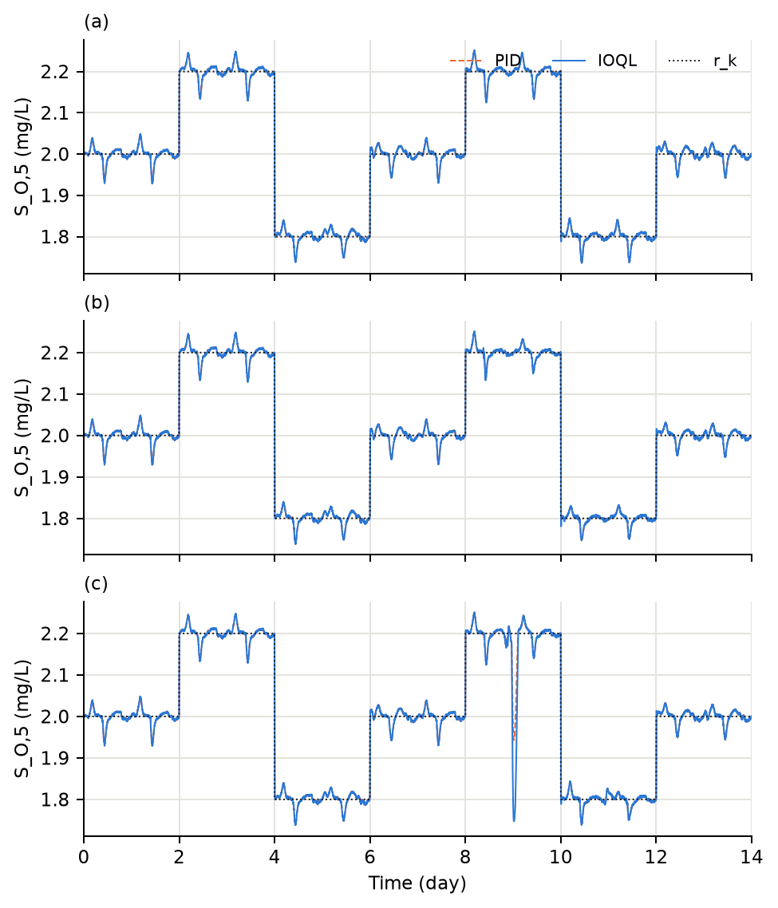

Dynamic reference: our PID follows the steps as in the paper; IOQL seed 0 equals PID.
*The published figure is in the paper (not reproduced here for copyright reasons).*

**Fig. 7. Trajectories of S_O,5 under IOQL with different prior policies and the dynamic r_k.**

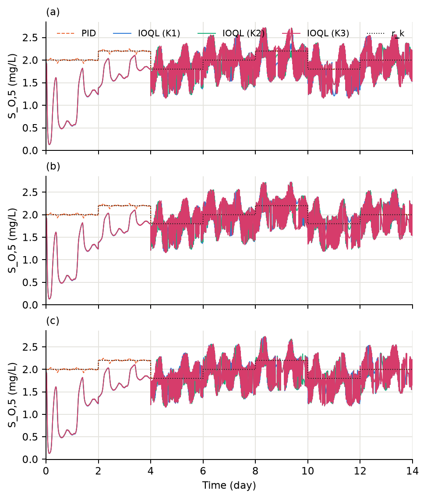

Same failure as in Fig. 5 with the dynamic reference.
*The published figure is in the paper (not reproduced here for copyright reasons).*

### 5.2 Tables I and III against our reimplementation

| Case | PID paper | PID ours | IOQL paper | IOQL ours (median) | IOQL ours, each run |
|---|---|---|---|---|---|
| Dry, fixed r | 0.0116 | 0.0113 | 0.00054 | 1.81 | 0.011 1.8 1.8 |
| Rain, fixed r | 0.0101 | 0.0105 | 0.000532 | 1.8 | 0.011 1.8 1.8 |
| Storm, fixed r | 0.0117 | 0.0113 | 0.000951 | 1.56 | 0.012 1.6 1.8 |
| Dry, dynamic r | 0.0116 | 0.0115 | 0.000528 | 1.81 | 0.011 1.8 1.8 |
| Rain, dynamic r | 0.0102 | 0.0107 | 0.000583 | 1.8 | 0.011 1.8 1.8 |
| Storm, dynamic r | 0.0152 | 0.0128 | 0.0049 | 1.61 | 0.014 1.6 1.8 |

*IAE of S_O,5. Ours: 3 runs per case.*

Result: PID reproduced within 5 % (dynamic storm: 16 % lower); IOQL not reproduced. As printed it either stays at the PID level or drives the aeration down until S_O,5 collapses. The utility term 0.01·u² (about 100–400 for KLa,5 = 100–200 d⁻¹) outweighs e² (about 10⁻⁴) by six orders of magnitude, so minimising Q lowers the air. The prior-policy experiments (Tables II and IV, priors K1–K3 with ω = 0.99^k) fail in the same way.

### 5.3 Our improvement: a retuned expert prior

The same approach as for paper 1: the prior's gain is raised by a factor chosen on dry weather with a fixed reference only (limit cycle at 6, chosen factor 4) and applied unchanged to rain, storm and the dynamic reference.

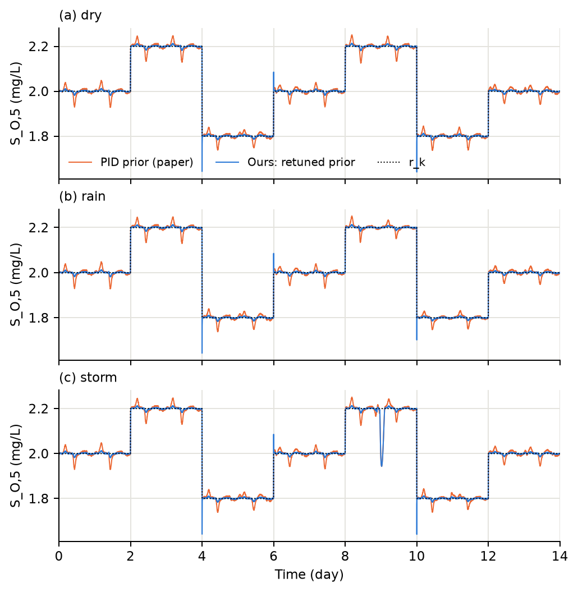

*Paper 3 set-up, dynamic reference: the paper's PID prior and our retuned prior.*

| Case | PID | IOQL (reimpl., median) | Ours | IOQL as published |
|---|---|---|---|---|
| Dry, fixed r | 0.0113 | 1.81 | 0.00297 (−74 %) | 0.00054 (−95 %) |
| Rain, fixed r | 0.0105 | 1.8 | 0.00279 (−74 %) | 0.000532 (−95 %) |
| Storm, fixed r | 0.0113 | 1.56 | 0.00314 (−72 %) | 0.000951 (−92 %) |
| Dry, dynamic r | 0.0115 | 1.81 | 0.00312 (−73 %) | 0.000528 (−95 %) |
| Rain, dynamic r | 0.0107 | 1.8 | 0.00295 (−72 %) | 0.000583 (−94 %) |
| Storm, dynamic r | 0.0128 | 1.61 | 0.00463 (−64 %) | 0.0049 (−68 %) |

*IAE of S_O,5.*

## 6. Overall comparison

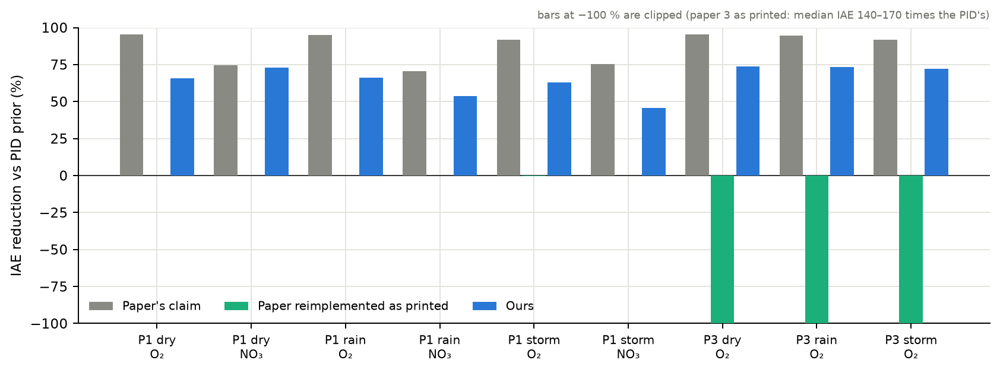

*Reduction of the tracking error relative to each paper's PID prior: as claimed in the paper, as obtained by reimplementing the paper exactly, and with our retuned prior.*

What is supported. On the official benchmark, the published learning controllers of papers 1 and 3 do not deliver their reported improvements when implemented as printed; our retuned prior delivers 63–74 % lower oxygen error in every weather and reference, including conditions it was not tuned on, without any learning. For paper 2 the energy saving of DDPG is reproduced in direction, and its cost in effluent compliance, not reported by the paper, is measured; our constrained agent did not improve on the PID.

What is not claimed. Our gains are smaller than the reductions claimed by papers 1 and 3 (oxygen 92–95 %, nitrate 71–76 %), which we could not obtain with any setting the papers allow. The retuned prior is a fixed controller chosen from dry-weather runs, not a learning method; under actuator noise its gain shrinks (oxygen −26 %, nitrate −42 %). All results are from simulation of one benchmark plant.

Findings that concern the papers themselves: paper 1 states set points [1, 2] but its figures and PID results correspond to [2, 1]; paper 1's critic update (eq. 15) grows without bound for slowly varying states; paper 1's noise experiment cannot be matched; paper 3's utility makes its learner lower the air; none of the three gives initial weights, input scaling or code.

## Appendix A. Simulation data and settings

### A.1. Purpose

This note records the plant model, the influent data and every setting used to reimplement the three base papers. Anyone with the repository and an internet connection can regenerate every number and figure from it.

- Paper 1: D. Wang, X. Li, J. Ren, J. Qiao, "Multiagent Adaptive Critic Control With Expert Knowledge for Wastewater Treatment Plants", IEEE Trans. Ind. Informat., 2026, doi:10.1109/TII.2026.3659924.
- Paper 2: S. L. Du, P. X. Chen, H. G. Han, J. F. Qiao, "Dissolved oxygen concentration control in wastewater treatment process based on reinforcement learning", Sci. China Tech. Sci. 66(9), 2549–2560, 2023, doi:10.1007/s11431-022-2403-8.
- Paper 3: M. Zhao, D. Wang, J. Ren, J. Qiao, "Integrated Online Q-Learning Design for Wastewater Treatment Processes", IEEE Trans. Ind. Informat. 21(2), 1833–1842, 2025, doi:10.1109/TII.2024.3488790.

All three papers use Benchmark Simulation Model No. 1 (BSM1) of the IWA Task Group on Benchmarking of Control Strategies. None of them publishes code, so the plant and the data below are the public benchmark, not the authors' own files.

### A.2. Plant model

The plant is the official BSM1 model as ported to Python by the bsm2-python package, version 0.0.16 (FAU-EVT, BSD-3 licence). That package reproduces the IWA MATLAB/Simulink implementation. We call it through src/wwtp/official/plant.py, which exposes the two inputs the papers manipulate and the two outputs they control.

| Item | Value |
|---|---|
| Biological model | ASM1, 13 state variables, 8 processes, 15 °C |
| Reactors | 5 in series: units 1–2 anoxic (1000 m³ each), units 3–5 aerated (1333 m³ each) |
| Secondary settler | 10 layers, area 1500 m², height 4 m, feed to layer 5; Takács double-exponential settling (v₀′ = 250, v₀ = 474 m/d, r_h = 5.76·10⁻⁴, r_p = 2.86·10⁻³ m³/g, f_ns = 2.28·10⁻³, X_t = 3000 g/m³) |
| Return sludge Q_r | 18 446 m³/d (fixed) |
| Wastage Q_w | 385 m³/d (fixed) |
| Internal recycle Q_a | 55 338 m³/d by default; manipulated in paper 1, range 0–92 230 m³/d |
| Oxygen transfer | KLa₁ = KLa₂ = 0, KLa₃ = KLa₄ = 240 d⁻¹; KLa₅ manipulated, range 0–240 d⁻¹, default 84 d⁻¹ |
| Oxygen saturation | 8 g/m³ |
| Kinetic parameters (15 °C) | μ_H 4.0 d⁻¹, K_S 10, K_OH 0.2, K_NO 0.5, b_H 0.3 d⁻¹, μ_A 0.5 d⁻¹, K_NH 1.0, K_OA 0.4, b_A 0.05 d⁻¹, η_g 0.8, k_a 0.05, k_h 3.0, K_X 0.1, η_h 0.8 |
| Stoichiometry | Y_H 0.67, Y_A 0.24, f_P 0.08, i_XB 0.08, i_XP 0.06, TSS/COD 0.75 |
| Controlled outputs | S_O,5 (dissolved oxygen in unit 5) and S_NO,2 (nitrate in unit 2) |

Each reactor is integrated over one control period with scipy.integrate.odeint inside bsm2-python; the settler is integrated the same way. The control period is 45 s for all three papers.

### A.3. Influent data

#### A.3.1 Source

The three standard BSM1 influent files (dry, rain and storm weather) are the IWA files Inf_dry_2006, Inf_rain_2006 and Inf_strm_2006. We take them in spreadsheet form from the public repository davidfernand/BSM1_in_Python, commit 5dadb20 (GPL-3). They are downloaded on first use into data/official/ and are not copied into this repository.

Two checks were made against bsm2-python, which ships the dry and rain files in its own format:

- The dry file is identical in every column and every row.
- The rain file has the same flows (to 0.003 m³/d) and the same concentrations, except for one column (S_I, below).

#### A.3.2 Format

Each file covers 14 days at 15-minute intervals, giving 1345 rows from t = 0 to t = 14 d. The columns are time, the 13 ASM1 concentrations (S_I, S_S, X_I, X_S, X_B,H, X_B,A, X_P, S_O, S_NO, S_NH, S_ND, X_ND, S_ALK) and the flow rate Q. The plant needs four more columns, which we add:

- total suspended solids, TSS = 0.75 (X_I + X_S + X_B,H + X_B,A + X_P);
- temperature, 15 °C;
- five dummy states, set to zero.

Between samples the influent is held constant.

#### A.3.3 Correction made

In the spreadsheets the inert soluble COD S_I is 30 g/m³ in every row of every file. In the official rain file distributed with bsm2-python, S_I is instead diluted by the rain water. It follows S_I = 30·Q_dry/Q, and we confirmed that rule against all 1344 rows of that file to within 0.005 g/m³. We apply the same rule to the rain and storm data; for dry weather it changes nothing.

S_I is biologically inert, so this correction affects only effluent COD and the effluent quality index. It does not affect the controlled variables.

#### A.3.4 The three weathers

| Weather | Week | Mean Q (m³/d) | Min–max Q (m³/d) | Flow-weighted COD (g/m³) | COD load (kg/d) | NH₄ load (kg N/d) | TSS (g/m³) |
|---|---|---|---|---|---|---|---|
| Dry | 1 | 18 446 | 10 000–32 180 | 381 | 7032 | 582 | 211 |
| Dry | 2 | 18 451 | 10 000–32 180 | 381 | 7034 | 582 | 211 |
| Rain | 2 | 24 189 | 10 000–52 126 | 291 | 7034 | 582 | 161 |
| Storm | 2 | 21 044 | 10 000–60 000 | 352 | 7402 | 582 | 198 |

Week 1 is the same dry-weather week in all three files. In the rain file a long rain period (days 8.4–10.4) raises the flow and dilutes the influent without adding load. In the storm file two short storms (around days 8.8 and 11) bring the flow up to 60 000 m³/d with a first flush of particulate matter, which is why its COD load is higher.

### A.4. Simulation protocol

- Initial state. Every run starts from the steady state supplied with bsm2-python.
- Warm-up. The plant is then run for 14 days on dry weather under the PID prior of the paper being reproduced:
- paper 1: KLa₅ and Q_a, set points 2 and 1 mg/L;
- paper 2: KLa₅ at a dissolved oxygen of 2 mg/L, Q_a fixed;
- paper 3: KLa₅ at 2 mg/L, Q_a fixed.

The plant state at the end of the warm-up is the start of every evaluation run, so every controller begins from the same plant.

- Evaluation. Each evaluation run covers the 14 days of the weather file in 45 s control periods (26 880 periods).
- Paper 2's split. Paper 2 learns on week 1 and is evaluated on week 2, as in that paper.
- Sensors. Sensors are ideal: no delay and no measurement noise.
- Paper 1's noise test. In the noise experiment of paper 1, zero-mean white noise with a standard deviation of 3 % of each actuator's upper bound (7.2 d⁻¹ on KLa₅, 2766.9 m³/d on Q_a) is added to the applied inputs, which are then limited to their ranges.
- Repeated runs. Repeated runs differ only in the random initial weights of the networks and, in the noise case, the noise sequence. They use seeds 0, 1, 2 and so on.

### A.5. Settings for each paper

#### A.5.1 Paper 1, MAACC

Taken from the paper, including its Table I:

| Setting | Value |
|---|---|
| Controlled variables and set points | S_O,5 = 2 mg/L via KLa₅; S_NO,2 = 1 mg/L via Q_a (see note below) |
| Prior strategy | incremental PID, K_p = diag(100, 100 000), K_i = diag(20, 30 000), K_d = diag(10, 1000) |
| Utility weights | W = (1, 2), Y = (0.5, 0.05), R = (10⁻⁴, 10⁻⁸), P₁ = 2I, P₂ = I; raw units |
| Discount, learning rates | λ = 0.95, l_c = 0.01, l_a = 0.005 |
| Hidden units | critic 12 and 14, action network 10 and 12; bipolar sigmoid; only outer weights learn; action-network outer weights start at zero |
| Critic update | eq. (15)–(18) as printed (TD(0) and residual-gradient readings were also checked, with the earlier [1, 2] set points; no difference) |
| Runs | 20 per case (dry, rain, storm, dry with noise) |

A note on the set points: the text of paper 1 writes r = [1, 2] for [S_O,5, S_NO,2], but its Figs. 4–6 and 8 show S_O,5 held at 2 mg/L and S_NO,2 at 1 mg/L, the standard BSM1 values. With [2, 1] our PID reproduces the paper's PID row (dry weather oxygen IAE 1.140·10⁻² against 1.14·10⁻²; storm 1.176·10⁻² against 1.17·10⁻²). With [1, 2] it does not, so [2, 1] is used.

Not given in the paper and chosen by us:

- initial inner weights uniform on [−1, 1];
- initial critic outer weights uniform on [−0.1, 0.1].

A sweep of twelve other initial scales is in results/summary_paper1_exact_init_sweep.json and is summarised in docs/REPORT.md. Code: src/wwtp/maacc/exact.py, experiments/20_exact_paper1.py.

#### A.5.2 Paper 2, DDPG

| Setting | Value |
|---|---|
| Control | KLa₅ only, no set point; Q_a at 55 338 m³/d |
| State, action | [S_S,5, S_O,5, S_NH,5]; increment of KLa₅ |
| Rewards | A: −(max(S_NH,e − 4, 0) + 0.38·max(N_tot,e − 18, 0)); B: −(AE + 0.42·max(S_NH,e − 4, 0)) |
| Networks | actor 3-256-256-1 (ReLU, tanh), critic 4-256-256-1 |
| Hyperparameters | γ 0.99, mini-batch 256, buffer 30 000, τ 0.001, learning rates 10⁻⁴ (actor) and 3·10⁻⁴ (critic) |
| Comparators | PID on S_O,5 = 2 mg/L (K_p 200, K_i 15, K_d 2) and a fuzzy controller |

Three corrections are applied in the main runs, because the agent did not learn as published on our first plant:

- the actuator setting KLa₅/240 is added to the state;
- each action is held for 15 minutes;
- the reward is scaled by 1 − γ.

AE enters the reward as KLa₅/240, because the paper does not give its units. Training uses 30 passes over the learning week, with exploration noise annealed from 0.35 to 0.05 and a replay buffer of 80 000 (the paper's is 30 000). One run exactly as published is reported separately.

Code: src/wwtp/rl/, experiments/06_aeration_benchmark.py --official.

#### A.5.3 Paper 3, IOQL

| Setting | Value |
|---|---|
| Control | KLa₅ only; Q_a at 55 338 m³/d |
| Reference | fixed, r = 2 mg/L; or dynamic, eq. (33): 2 / 2.2 / 1.8 mg/L in two-day blocks |
| Prior policy | PID K_p 100, K_i 20, K_d 1; for the prior study K1 (80, 15, 10), K2 (100, 30, 10), K3 (120, 25, 10) with ω = 0.99^k |
| Weighting | ω = 1 in the main runs |
| Utility | G = e² + 0.01·u², with e = S_O,5 − r and u = ωα + β; γ = 1 |
| Networks | 15 hidden units each, tanh; only the outer weights learn |
| Learning | l_c = 0.01, l_a = 0.005; 50 critic and 60 action-network training steps per control period |
| Runs | 3 per case |

Not given in the paper and chosen by us:

- initial weights uniform on [−1, 1];
- the input applied in a period is the one after that period's updates;
- u is limited to 0–240 d⁻¹.

Code: src/wwtp/ioql/ioql.py, experiments/23_ioql.py.

### A.6. Performance measures

For a run of N control periods, with tracking error e = S − r:

- IAE = (1/N) Σ |e|
- ISE = (1/N) Σ e²
- DEV_max = max |e|

These follow eq. (36) of paper 1 and eq. (32) of paper 3. Paper 2 uses:

- AE = (S_O,sat / 1800) Σ V_i KLa_i (kWh/d);
- the BSM1 effluent quality index EQ (kg pollution units/d);
- effluent concentrations averaged over the evaluation week.

### A.7. Files

| File | Contents |
|---|---|
| results/published_paper{1,2,3}.json | numbers typed in from each paper's tables |
| results/summary_paper1_exact2.json, traces_paper1_exact2.json | paper 1 runs and trajectories |
| results/summary_fig_p2_*.json, traces_fig_p2_*.json | paper 2 runs and trajectories |
| results/summary_ioql.json, traces_ioql.json | paper 3 runs and trajectories |
| docs/figures/reproduced/ | every figure of the three papers, redrawn from these runs |
| docs/REPORT.md | the full comparison with the papers |

## Appendix B. Implementation

| Item | File |
|---|---|
| Official BSM1 plant, influent loading and correction | src/wwtp/official/plant.py |
| Paper 1, MAACC exactly as printed | src/wwtp/maacc/exact.py |
| Paper 1 experiments (Tables II, III; gain sweep; retuned prior) | experiments/20_exact_paper1.py |
| Paper 2, environment, DDPG, rewards, comparators | src/wwtp/rl/env.py, ddpg.py, rewards.py, baselines.py |
| Paper 2 experiments (official plant) | experiments/06_aeration_benchmark.py --official |
| Paper 2, Fig. 4 (effluent vs DO set point) | experiments/26_fig4_official.py |
| Paper 2, constrained agent (PANDA-RL) | src/wwtp/rl/panda_rl.py |
| Paper 3, IOQL exactly as printed | src/wwtp/ioql/ioql.py |
| Paper 3 experiments (Tables I–IV; retuned prior) | experiments/23_ioql.py |
| Redrawn diagrams; reproduced result figures; our figures | experiments/24_diagrams.py, 25_paper_figures.py, 27_ours_figures.py |
| Published values typed in from the papers | results/published_paper1.json, _paper2.json, _paper3.json |
| This report | tools/build_report.py |
| Tests (82) | tests/ |

Commands, from the repository root:

```
pip install -r requirements.txt
python -m pytest tests -q
python experiments/20_exact_paper1.py --seeds 20 --noise --critics paper --tag exact2
python experiments/20_exact_paper1.py --controllers PIDx3 --seeds 1 --weathers dry rain storm --tag ours_p1_clean
python experiments/23_ioql.py --seeds 3
python experiments/23_ioql.py --methods PID PIDx4 --tag ours_p3
python experiments/06_aeration_benchmark.py --official --weathers dry rain storm --methods PID Fuzzy DDPG-A DDPG-B
python experiments/26_fig4_official.py
python experiments/24_diagrams.py && python experiments/25_paper_figures.py && python experiments/27_ours_figures.py
python tools/build_report.py --md docs/REPORT.md
```

## Appendix C. Runs behind this report

| Experiment | Runs |
|---|---|
| Paper 1 as printed (dry, rain, storm, dry + noise; 20 each, plus PID) | 103 |
| Paper 1 initial-weight sweep | 24 |
| Paper 1 gain sweep (dry) and retuned prior (all cases) | 45 |
| Paper 2 PID, fuzzy, DDPG-A, DDPG-B (dry, rain, storm) | 26 |
| Paper 2 as published (dry) | 1 |
| Paper 2 constrained agent (dry, rain, storm, 2 each) | 6 |
| Paper 2 Fig. 4 steady-state set points | 8 |
| Paper 3 IOQL (fixed and dynamic; PID, IOQL, K1–K3; 3 each) | 78 |
| Paper 3 gain sweep (dry) and retuned prior (all cases) | 18 |

## References

[1] D. Wang, X. Li, J. Ren, J. Qiao, "Multiagent Adaptive Critic Control With Expert Knowledge for Wastewater Treatment Plants", IEEE Transactions on Industrial Informatics, 2026, doi:10.1109/TII.2026.3659924.

[2] S. L. Du, P. X. Chen, H. G. Han, J. F. Qiao, "Dissolved oxygen concentration control in wastewater treatment process based on reinforcement learning", Science China Technological Sciences 66(9), 2549–2560, 2023, doi:10.1007/s11431-022-2403-8.

[3] M. Zhao, D. Wang, J. Ren, J. Qiao, "Integrated Online Q-Learning Design for Wastewater Treatment Processes", IEEE Transactions on Industrial Informatics 21(2), 1833–1842, 2025, doi:10.1109/TII.2024.3488790.

[4] J. Alex et al., Benchmark Simulation Model no. 1 (BSM1), IWA Task Group on Benchmarking of Control Strategies for WWTPs, Lund University, 2008.

[5] bsm2-python 0.0.16, FAU-EVT, Python implementation of the IWA benchmark simulation models (BSD-3).
